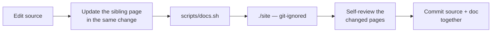

# AGENTS.md



Guidance for agents (and humans) working in this repository.

## Project Overview

Logamuffin is a lightweight, cross-platform logging utility built in C++20 with an optional Bash helper. It ships a standalone `logamuffin` executable for shell scripts, build pipelines, and command-line tools — no interpreter or framework required at runtime. It is also published as a prebuilt binary consumed by the `fordaj/*` tooling ecosystem (this repository's own scripts log through the bundled binary under `tools/logamuffin/`).

Key properties (see [README.md](README.md) for the full feature list):

- Severity levels as words (`INFO`) or numbers (`50`), including custom categories with their own values and colors.
- Configuration via environment variables, a JSON config file (`./.logamuffin` autodiscovery or `--config`/`LOG_CONFIG`), and defaults → file → environment precedence.
- INFO-and-below to stdout, ERROR-and-above (value ≥ 40) to stderr; plain-text persistent file logging with concurrent-write protection.
- A Bash `log` helper (`scripts/log.sh`) that adds call-site `LOG_SOURCE` tracking.

## Core Principles

- **No runtime dependency on an interpreter.** The binary must stay dependency-free; the only vendored third-party code is the doctest header under `tools/doctest/`.
- **Useful defaults, configuration when needed.** Every behavior configurable via env/JSON must keep working with zero configuration.
- **Single sources of truth.** Translation units in `tools/sources.sh`; built-in levels in `logamuffin.hpp`'s `kBuiltinLevels`; aliases in `log_levels.hpp`'s `kLevelAliases`; color constants in `ansi_colors.hpp`; tool pins in `scripts/.common.env`. Extend those, never copy them.
- **Preserve the CLI contract.** Exit code `0` on success/filtered, `2` on usage/config errors; stdout/stderr routing by value 40 is documented and tested.
- **Docs next to code.** Every documented file has a sibling page with the documented file's suffix retained (see "Documentation files (barnacle)").
- **Mermaid-forward.** Every page opens with a Mermaid diagram right under its `#` heading — the reader gets the map before the territory. This is guidance, never a hard rule: barnacle only prints a non-fatal stderr note listing pages without a diagram (`warnMissingMermaid` in `.barnacle.json`, default `true`). This repository holds to zero such pages; when you add or rewrite a page, open it with a diagram — a flowchart, class diagram, sequence diagram, state diagram — whatever best communicates the thing you are documenting to someone who has never seen it.

## Build / Test / Format

All of these are the real entry points — do not invent others.

```bash
# Build (BUILD_MODE=release|debug; Zig + native clang++)
BUILD_MODE=debug scripts/build.sh

# Test (C++ unit tests via doctest + Python CLI integration tests)
./scripts/run_tests.sh                      # full suite
./scripts/run_tests.sh --skip-unit          # integration only
./scripts/run_tests.sh --skip-integration   # unit only

# Format in place / check formatting (CI uses --check)
./scripts/format.sh
./ci/format_check.sh

# Docs site (output ./site/, git-ignored)
scripts/docs.sh

# Version (via bundled Versioner)
scripts/version.sh
```

Requirements: a C++20 compiler (`clang++` default), Python 3 (stdlib only) for the integration suite, Bash, and for cross-compiled release targets Zig. CI (`.github/workflows/ci.yml`) runs `./ci/format_check.sh` on macOS and Windows and `./scripts/run_tests.sh` on macOS, on self-hosted runners. Releases go through `scripts/release.sh`.

## Repository Layout

- Root: the C++ library and executable (`*.cpp`/`*.hpp`), shell entry points (`scripts/demo.sh`, `scripts/format.sh`, `scripts/log.sh`, `scripts/run_tests.sh`, `scripts/test.sh`), `tests/` (unit + CLI integration), `docs/TESTING.md`, `pyproject.toml`/`uv.lock` (formattington pin), `.formattington.json`, `.versioner.json`, `.runner-spawner.json`.
- `scripts/` — build/release/docs tooling plus the hidden env cascade (`.common.env`, `.<platform>.env`). See `scripts/README.md`.
- `tools/` — pinned helper bundles (versioner, logamuffin, runner-spawner, barnacle, formattington-lite), helpers (`generate_version.sh`, `sources.sh`), and vendored doctest. See `tools/README.md`.
- `agents/` — agent prompt files; not part of the docs flow and excluded from the generated site via `.barnacle.json`.
- `build/`, `dist/`, `site/`, `.version/`, `.runners/` — generated; git-ignored, never committed.
- `.github/workflows/ci.yml` — CI.

## Documentation files (barnacle)

The repository's documentation is a set of Markdown (`.md`) source files rendered into a static site by the pinned [barnacle](https://github.com/fordaj/barnacle) binary (`tools/barnacle/`, wired into the environment cascade as `BARNACLE_BIN`). Generate the site with `scripts/docs.sh`; the output (`./site/`) is git-ignored and never committed. `.barnacle.json` at the repository root sets the site title (`logamuffin`) and excludes `tools/` (pinned binaries carry their own upstream docs), `build/` (generated), `dist/`, and `agents/` (agent prompts, not documentation).

Layout — documentation lives next to the code it describes:

- One sibling page per C++ module at the repository root. Module pairs are documented together on one page named for the **`.cpp` translation unit** (matching `tools/sources.sh`): `color.cpp` + `color.hpp` → `color.cpp.md`; `config.cpp` + `config.hpp` → `config.cpp.md`; `json_parser.cpp` + `json_parser.hpp` → `json_parser.cpp.md`; `log_levels.cpp` + `log_levels.hpp` → `log_levels.cpp.md`; `platform.cpp` + `platform.hpp` → `platform.cpp.md`; `text_utils.cpp` + `text_utils.hpp` → `text_utils.cpp.md`. `logamuffin_core.cpp` has no header of its own and is documented with the executable it serves on `logamuffin.cpp.md` (which covers `logamuffin.cpp`, `logamuffin.hpp`, and `logamuffin_core.cpp`). The header-only `ansi_colors.hpp` is named `ansi_colors.hpp.md`.
- One sibling `.sh.md` per script in `scripts/` (for example `scripts/build.sh` → `scripts/build.sh.md`; `scripts/run_tests.sh` → `scripts/run_tests.sh.md`), plus `scripts/README.md` as the hub.
- One page per helper in `tools/` (`tools/generate_version.sh` → `tools/generate_version.sh.md`, `tools/sources.sh` → `tools/sources.sh.md`), one `update.sh.md` per bundle's `update.sh` (`tools/<name>/update.sh.md` for `barnacle`, `formattington-lite`, `logamuffin`, `runner-spawner`, `versioner`), and `tools/doctest/README.md` for the vendored doctest bundle — plus `tools/README.md` as the hub. These exist for the repository, not the site (`.barnacle.json` excludes `tools/`).
- `docs/TESTING.md` predates this system and stays as the testing guide; it is linked from the README and these pages, not duplicated.
- `pyproject.toml` / `uv.lock` are configuration, not code — no sibling pages. `tests/` has no sibling pages either.

Naming rules:

- **Retain the documented file's suffix.** A documentation file for `main.cpp` is `main.cpp.md`; for `scripts/build.sh` it is `scripts/build.sh.md` (or the `.mmd` equivalent). Hub pages (`README.md`) keep their plain names; free-standing guides (`docs/TESTING.md`) too. Module pairs are named for the `.cpp` — see above; that is the one place a page covers more than one documented file, and the choice is deliberate.

Rules for keeping these files current:

- When you add, rename, remove, or repurpose a documented file — a C++ module, a script, or a bundle — update its sibling page **in the same change**. A new file without its page is incomplete work; a stale page is worse than none.
- **Every page opens with a Mermaid diagram** under its `#` heading (guidance, not a hard rule): what the thing is and how it fits, in the diagram type that fits best. If a page you touch has no diagram at the top, add one.
- Diagram nodes may link between pages: `click Node href "target.md"`, with the target written relative to the page exactly like a Markdown link (`.md`/`.mmd` rewrite to `.html`). Prefer this in the top-of-page diagram. Transitions work the same way with an inline anchor in the label (`Idle --> Waiting : <a href="page.md">send(cmd)</a>`); flowchart labels that contain parens must be double-quoted with single-quoted hrefs inside (`A -->|"<a href='x.md'>send(cmd)</a>"| B`), and state-diagram labels may not contain `:` at all.
- Rendered pages must not hyperlink into `tools/` (it is excluded from the site) — refer to those pages as code (for example `tools/barnacle/update.sh.md`).
- Source every fact: the `.cpp`/`.hpp`/`.sh`/`.bash` file itself, this file (AGENTS.md), and README.md are the accepted sources. Never invent flags, exit codes, extensions, or bundle-platform matrices.
- Use plain relative links (`color.cpp.md`, `../../scripts/env.sh.md`) with the linking file's `.md` path — barnacle rewrites them to `.html`. Do not link to files barnacle does not render (binaries, `.sh`, `LICENSE`, or the `tools/` tree); link the related page instead. For external references, a full `https://` URL is fine.
- A `foo.md` and a `foo.mmd` may not coexist for the same stem — barnacle fails the whole site rather than overwriting.
- Hub pages (`scripts/README.md`, `tools/README.md`) list their siblings; adding a page means linking it from the hub too.
- Barnacle skips hidden files by default, so the `.common.env` and `.<platform>.env` cascade is documented inside `scripts/env.sh.md` — keep it accurate there instead of adding hidden doc files.
- Regenerate and self-review the site before publishing: `scripts/docs.sh`, then click through the changed pages. The generator output must remain free of broken local links, and the run must not print the `page(s) have no Mermaid diagram` note.

Definition of Done addition: a change that touches any documented file updates (or creates) its sibling page in the same commit — including the diagram at the top.

## Definition of Done

A change is complete when it:

- Implements the requested behavior.
- Preserves the established CLI contract (exit codes, stdout/stderr routing, documented env vars) unless intentionally changed, and keeps README examples consistent with the implementation.
- Handles errors appropriately and stays compatible with the supported platforms (macOS, Windows, Linux; see `scripts/.common.env`).
- Builds and tests cleanly: `./scripts/run_tests.sh` passes, and `./ci/format_check.sh` is clean.
- Includes or updates tests where appropriate.
- Updates relevant documentation — including the sibling `.md` pages above for every documented file touched — and keeps `scripts/docs.sh` free of broken local links, with no page listed in its missing-diagram note.
