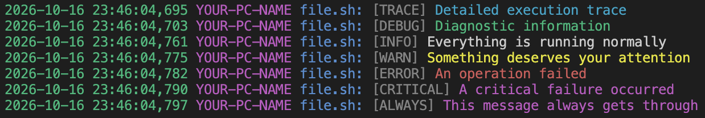

# logamuffin

Logamuffin is a lightweight, cross-platform logging utility built in C++20. It brings readable, colorized logging to shell scripts, build pipelines, and command-line tools — without requiring a logging framework or a scripting-language runtime.

```bash
logamuffin INFO "Build started"
logamuffin WARNING "Configuration file not found; using defaults"
logamuffin ERROR "Compilation failed"
```

Simple commands. Consistent output. Logs you can actually read.

<!-- Add a terminal screenshot here. -->

## Features

- **Standalone executable** — no Python, Node.js, or other scripting runtime required.
- **Cross-platform** — builds for macOS, Windows, and Linux.
- **Multiple severity levels** — filter messages by importance.
- **Colorized terminal output** — distinguish informational messages, warnings, and errors at a glance.
- **Persistent file logging** — append messages to a log file across invocations.
- **Configurable through environment variables** — adjust logging behavior without recompiling.
- **Concurrent-write protection** — synchronize file writes across competing processes.
- **Automatic version reporting** — identify the installed version with `--version`.
- **Shell-friendly** — designed to work naturally in scripts, pipelines, and automation.

## Installation

Download the archive matching your operating system and CPU architecture from the project's GitHub Releases page.

| Platform | Architecture        |
| -------- | ------------------- |
| macOS    | Intel x86-64        |
| macOS    | Apple Silicon ARM64 |
| Windows  | x86-64              |
| Windows  | ARM64               |
| Linux    | x86-64 (musl)       |
| Linux    | ARM64 (musl)        |

Extract the downloaded archive. The executable is located at the root of the archive.

On macOS and Linux, make it executable if necessary:

```bash
chmod +x logamuffin
```

You can run it directly or place it somewhere on your `PATH`.

For example, to install it into a user-local binary directory:

```bash
mkdir -p "$HOME/.local/bin"
install -m 755 logamuffin "$HOME/.local/bin/logamuffin"
```

Ensure `$HOME/.local/bin` is included in your `PATH`.

Verify the installation:

```bash
logamuffin --version
```

> Windows users should invoke `logamuffin.exe` or add its containing directory to `PATH`.

## Usage

### Basic syntax

```text
logamuffin LEVEL MESSAGE [MESSAGE ...]
```

`LEVEL` determines the severity of the message. The remaining arguments form the message text.

```bash
logamuffin INFO "Starting application"
logamuffin WARNING "Retrying connection"
logamuffin ERROR "Unable to connect to server"
```

### Severity levels

| Level      | Numeric value | Purpose                                       |
| ---------- | ------------: | --------------------------------------------- |
| `TRACE`    |             5 | Very detailed execution information           |
| `DEBUG`    |            10 | Diagnostic information for development        |
| `INFO`     |            20 | Normal application activity                   |
| `WARNING`  |            30 | Unexpected conditions that may need attention |
| `ERROR`    |            40 | An operation failed                           |
| `CRITICAL` |            50 | A serious failure                             |
| `ALWAYS`   |            -1 | Messages that bypass severity filtering       |

By default, the logging threshold is `INFO`. Messages below the configured threshold are filtered out. `ALWAYS` messages bypass this filter.

### Examples

**Log a successful operation:**

```bash
logamuffin INFO "Configuration loaded"
logamuffin INFO "Application ready"
```

**Report an error and exit:**

```bash
if ! some_command; then
    logamuffin ERROR "some_command failed"
    exit 1
fi
```

**Enable verbose logging while debugging:**

```bash
LOG_LEVEL=TRACE logamuffin TRACE "Entering initialization"
LOG_LEVEL=TRACE logamuffin DEBUG "Initialization complete"
```

**Use it in a build script:**

```bash
#!/usr/bin/env bash
set -euo pipefail

logamuffin INFO "Building application"

if ! cmake --build build; then
    logamuffin ERROR "Build failed"
    exit 1
fi

logamuffin INFO "Build completed successfully"
```



## Configuration

Logamuffin uses environment variables so you can customize its behavior without recompiling the executable.

| Variable     | Default                    | Description                               |
| ------------ | -------------------------- | ----------------------------------------- |
| `LOG_LEVEL`  | `INFO`                     | Minimum severity to display               |
| `LOG_COLOR`  | Automatic/default behavior | Controls colored terminal output          |
| `LOG_FILE`   | `.logs/log.log`            | Path to the persistent log file           |
| `LOG_SOURCE` | Implementation default     | Controls source information in log output |

### Set the logging threshold

```bash
LOG_LEVEL=DEBUG logamuffin DEBUG "Detailed diagnostic message"
LOG_LEVEL=WARNING logamuffin INFO "This message is filtered"
LOG_LEVEL=WARNING logamuffin ERROR "This message is displayed"
```

Configuration applies to each invocation, making it convenient to override settings for individual commands.

To configure an entire script, export the variables:

```bash
export LOG_LEVEL=DEBUG
export LOG_FILE="$HOME/.logs/my-application.log"

logamuffin INFO "Application started"
logamuffin DEBUG "Loading configuration"
```

### Configure the log file

By default, messages are appended to `.logs/log.log`.

Choose another location when needed:

```bash
LOG_FILE="$HOME/.logs/application.log" \
    logamuffin INFO "Application started"
```

The log file contains plain text rather than terminal color escape sequences.

### Control terminal colors

Use `LOG_COLOR` to control colorized output:

```bash
LOG_COLOR=1 logamuffin INFO "Colorized message"
LOG_COLOR=0 logamuffin INFO "Plain message"
```

Color support is intended for terminal output; persistent file logs remain plain text.

> Exact color behavior can depend on the executable's current implementation and terminal environment.

## Output behavior

Logamuffin separates ordinary messages from errors to work naturally with shell scripts:

- `TRACE`, `DEBUG`, `INFO`, and `WARNING` messages go to standard output.
- `ERROR` and `CRITICAL` messages go to standard error.
- `ALWAYS` bypasses the configured severity threshold.
- Terminal output can include ANSI colors and contextual metadata.
- File output is plain text and is appended to the configured log file.

This makes it possible to redirect normal output and error messages independently:

```bash
logamuffin INFO "Processing files" >> application.out
logamuffin ERROR "Processing failed" 2>> application.err
```

For scripts that capture output, remember that standard output and standard error are separate streams.

## Building from source

Logamuffin is written in C++20 and can be built using a native compiler and Zig for cross-compilation.

### Requirements

- A C++ compiler with C++20 support, such as Clang.
- Zig for the configured cross-compilation targets.
- Bash for the build and release scripts.
- `tar`, `zip`, and a SHA-256 utility for packaging releases.

### Build

Clone the repository and run the build script:

```bash
git clone <repository-url>
cd logamuffin
chmod +x build.sh release.sh
./build.sh
```

The build script supports release and debug configurations.

```bash
BUILD_MODE=debug ./build.sh
BUILD_MODE=release ./build.sh
```

Build outputs are organized by platform and architecture.

### Create release archives

Run:

```bash
./release.sh
```

The release script builds the configured targets, packages their executables into platform-specific archives, and generates a `SHA256SUMS` file.

To package existing binaries without rebuilding:

```bash
RUN_BUILD=false ./release.sh
```

To override the release version:

```bash
VERSION=0.1.1 ./release.sh
```

Otherwise, the release version is derived from `version.hpp`.

## Design philosophy

Logamuffin aims to be a small, dependable utility that does one thing well.

- **No runtime dependency on an interpreter.**
- **No framework required in the calling application.**
- **No recompilation just to change basic logging settings.**
- **Useful defaults, with configuration available when you need it.**

It's intended for shell scripts and standalone automation, not as a replacement for every application's specialized logging framework.

## License

See [LICENSE](LICENSE) for licensing information.

---
