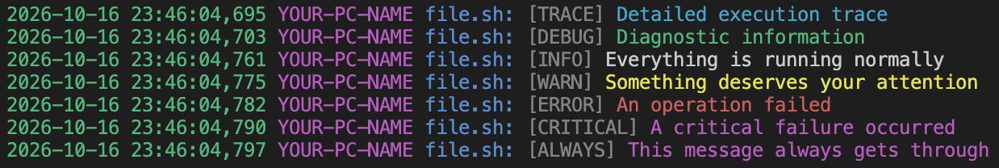

# logamuffin

Logamuffin is a lightweight, cross-platform logging utility built in C++20. It brings readable, colorized logging to shell scripts, build pipelines, and command-line tools — without requiring a logging framework or a scripting-language runtime.

```bash
logamuffin INFO "Build started"
logamuffin WARNING "Configuration file not found; using defaults"
logamuffin ERROR "Compilation failed"
```

Simple commands. Consistent output. Logs you can actually read.

<!-- Add a terminal screenshot here. -->

## Features

- **Standalone executable** — no Python, Node.js, or other scripting runtime required.
- **Cross-platform** — builds for macOS, Windows, and Linux.
- **Multiple severity levels** — filter messages by importance.
- **Word and numeric levels** — use names (`TRACE`, `INFO`) or numbers (`50`) interchangeably.
- **Bash `log` helper** — source `log.sh` for terse `log` calls with automatic source tracking.
- **Extensible categories** — define custom log categories with their own numeric values and colors.
- **Colorized terminal output** — distinguish informational messages, warnings, and errors at a glance.
- **Persistent file logging** — append messages to a log file across invocations.
- **Configurable through environment variables** — adjust logging behavior without recompiling.
- **JSON config file support** — set categories, values, colors, threshold, and more with `--config <path>` or an autodiscovered `./.logamuffin` file.
- **Concurrent-write protection** — synchronize file writes across competing processes.
- **Automatic version reporting** — identify the installed version with `--version`.
- **Shell-friendly** — designed to work naturally in scripts, pipelines, and automation.

## Installation

Download the archive matching your operating system and CPU architecture from the project's GitHub Releases page.

| Platform | Architecture        |
| -------- | ------------------- |
| macOS    | Intel x86-64        |
| macOS    | Apple Silicon ARM64 |
| Windows  | x86-64              |
| Windows  | ARM64               |
| Linux    | x86-64 (musl)       |
| Linux    | ARM64 (musl)        |

Extract the downloaded archive. The executable is located at the root of the archive.

On macOS and Linux, make it executable if necessary:

```bash
chmod +x logamuffin
```

You can run it directly or place it somewhere on your `PATH`.

For example, to install it into a user-local binary directory:

```bash
mkdir -p "$HOME/.local/bin"
install -m 755 logamuffin "$HOME/.local/bin/logamuffin"
```

Ensure `$HOME/.local/bin` is included in your `PATH`.

Verify the installation:

```bash
logamuffin --version
```

> Windows users should invoke `logamuffin.exe` or add its containing directory to `PATH`.

## Usage

### Basic syntax

```text
logamuffin [--config <path>] LEVEL MESSAGE [MESSAGE ...]
```

`LEVEL` is a severity name (e.g. `TRACE`, `INFO`, `ERROR`) **or** a numeric value (e.g. `50`). The remaining arguments form the message text. `--config <path>` (or `--config=<path>`) selects a JSON config file, and `--help` / `--version` print help and version information.

```bash
logamuffin INFO "Starting application"
logamuffin WARNING "Retrying connection"
logamuffin ERROR "Unable to connect to server"
logamuffin 50 "A serious failure (same as CRITICAL)"
logamuffin TRACE "Very detailed execution information"
```

### Severity levels

| Level      | Numeric value | Purpose                                       |
| ---------- | ------------: | --------------------------------------------- |
| `TRACE`    |             5 | Very detailed execution information           |
| `DEBUG`    |            10 | Diagnostic information for development        |
| `INFO`     |            20 | Normal application activity                   |
| `WARNING`  |            30 | Unexpected conditions that may need attention |
| `ERROR`    |            40 | An operation failed                           |
| `CRITICAL` |            50 | A serious failure                             |
| `ALWAYS`   |            -1 | Messages that bypass severity filtering       |

By default, the logging threshold is `INFO`. Messages below the configured threshold are filtered out. `ALWAYS` messages bypass this filter.

The defaults above are starting points, not hard-coded. You can override each category's numeric value and color — and add new categories — through environment variables or a JSON config file. For example, a custom `NOTICE` at value 25 becomes `logamuffin NOTICE "message"` once defined. Custom categories at value 40 or above, and categories named `ERROR`/`CRITICAL`/`FATAL`, write to standard error; all others write to standard output. `WARN` is an alias for `WARNING` and `FATAL` is an alias for `CRITICAL`. Thresholds may name a category (`LOG_LEVEL=NOTICE`) or be a numeric value (`LOG_LEVEL=25`); named thresholds resolve against the configured values, so redefining a category also moves thresholds that refer to it.

Levels can also be given as numbers (issue #3). `logamuffin 50 "message"` resolves to the category whose value is 50 — `CRITICAL` with the defaults — and `logamuffin 25 "message"` resolves to a custom `NOTICE` when one is defined. A number that does not match any configured value is logged as an ad-hoc level with that number as its label (for example `[25]`), with the default color; it is still filtered against `LOG_LEVEL` and written to standard error when its value is 40 or above. `-1` resolves to `ALWAYS` and bypasses filtering. The Bash `log` helper documented below supports words and numbers identically.

### Examples

**Log a successful operation:**

```bash
logamuffin INFO "Configuration loaded"
logamuffin INFO "Application ready"
```

**Report an error and exit:**

```bash
if ! some_command; then
    logamuffin ERROR "some_command failed"
    exit 1
fi
```

**Enable verbose logging while debugging:**

```bash
LOG_LEVEL=TRACE logamuffin TRACE "Entering initialization"
LOG_LEVEL=TRACE logamuffin DEBUG "Initialization complete"
```

**Use it in a build script:**

```bash
#!/usr/bin/env bash
set -euo pipefail

logamuffin INFO "Building application"

if ! cmake --build build; then
    logamuffin ERROR "Build failed"
    exit 1
fi

logamuffin INFO "Build completed successfully"
```

### Bash helper: the `log` function (issue #2)

Instead of invoking `logamuffin` everywhere, source `log.sh` and call `log`:

```bash
source /path/to/log.sh   # or source ./log.sh from this repo

log INFO "Starting application"
log TRACE "Very detailed execution information"
log 50 "A serious failure"
```

`log` sets up everything so call sites stay terse: it resolves the caller's file, function, and line number and passes it to `logamuffin` as `LOG_SOURCE` (`my-script.sh:myfunc:42` → shown as `my-script.sh:myfunc:42` in the source field), forwards the `LEVEL` (a word such as `INFO` or a number such as `50`) and message exactly as given, and preserves `logamuffin`'s exit code. It does not override your `LOG_LEVEL`, `LOG_FILE`, `LOG_COLOR`, `LOG_CONFIG`, `LOG_LEVELS`, or other configuration — export them once per script and `log` respects them (with `logamuffin`'s defaults when unset), so the usual precedence (defaults → `./.logamuffin` → `LOG_CONFIG`/`--config` → environment) still works. `LOG_SOURCE` is the exception: `log` always sets it per call from the call site (call `logamuffin` directly for a fixed custom source).

For a whole-script setup:

```bash
#!/usr/bin/env bash
set -euo pipefail

export LOG_LEVEL=INFO     # minimum level for the script
export LOG_FILE=".logs/my-app.log"
source ./log.sh           # provides log(); needs logamuffin on PATH

log INFO "Application started"
log DEBUG "Loading configuration"
```

The copy-paste function (also shipped as [`log.sh`](log.sh) at the repository root — source that file to get the identical behavior):

```bash
log() {
  local bin
  if [[ -n "${LOGAMUFFIN_BIN:-}" ]]; then
    bin="$LOGAMUFFIN_BIN"
  elif command -v logamuffin >/dev/null 2>&1; then
    bin="$(command -v logamuffin)"
  else
    bin="logamuffin"
  fi

  local caller_file="${BASH_SOURCE[1]:-}"
  local caller_line="${BASH_LINENO[0]:-1}"
  local caller_func=""
  if (( ${#FUNCNAME[@]} > 1 )); then
    caller_func="${FUNCNAME[1]:-}"
  fi
  if [[ -z "$caller_file" ]]; then
    caller_file="${0:-log}"
  fi

  local src
  if [[ -n "$caller_func" && "$caller_func" != "log" && "$caller_func" != "main" ]]; then
    src="${caller_file}:${caller_func}:${caller_line}"
  else
    src="${caller_file}:${caller_line}"
  fi

  LOG_SOURCE="$src" "$bin" "$@"
  return $?
}
```

Tip: point `LOGAMUFFIN_BIN` at a build output when `logamuffin` is not on `PATH` (the demo and tests use the debug build under `build/debug/logamuffin`). The helper is Bash-only; in Zsh capture the call site with `${(%):-%N}` / `$LINENO` instead of `BASH_SOURCE`/`FUNCNAME`.



Run `./demo.sh` to see every capability above in action in one
visual pass (version/help, levels and colors, numeric levels,
filtering, streams, env and JSON configuration and precedence, file
logging, concurrent writes, shell patterns, and the `log` helper).
Re-run it after any change to compare outputs for regressions;
recapture `image.png` from the new run.

## Configuration

Logamuffin uses environment variables, an optional JSON config file, and a `--config` option so you can customize its behavior without recompiling the executable.

| Variable                 | Default                    | Description                                                                             |
| ------------------------ | -------------------------- | --------------------------------------------------------------------------------------- |
| `LOG_LEVEL`              | `INFO`                     | Minimum severity to display (a category name or numeric value)                          |
| `LOG_COLOR`              | Automatic/default behavior | Controls colored terminal output (`1`/`TRUE`/`YES`/`ON` enable, anything else disables) |
| `LOG_FILE`               | `.logs/log.log`            | Path to the persistent log file                                                         |
| `LOG_SOURCE`             | Implementation default     | Controls source information in log output                                               |
| `LOG_CONFIG`             | —                          | Path to a JSON config file (same as `--config`)                                         |
| `LOG_LEVELS`             | —                          | Custom categories, e.g. `NOTICE=25:blue,INFO=20:green`                                  |
| `LOG_CATEGORIES`         | —                          | Alias for `LOG_LEVELS` (`LOG_LEVELS` wins per entry if both are set)                    |
| `LOG_LEVEL_VALUE_<NAME>` | —                          | Numeric value for a single category, e.g. `LOG_LEVEL_VALUE_NOTICE=25`                   |
| `LOG_LEVEL_COLOR_<NAME>` | —                          | Color for a single category, e.g. `LOG_LEVEL_COLOR_NOTICE=blue`                         |

The spellings `LOG_LEVEL_<NAME>_VALUE` / `LOG_LEVEL_<NAME>_COLOR` are also accepted, and all `LOG_*` category variables have `LOGAMUFFIN_*` equivalents (e.g. `LOGAMUFFIN_LEVELS`). Later sources win over earlier ones (see [Configuration precedence](#configuration-precedence)).

### Set the logging threshold

```bash
LOG_LEVEL=DEBUG logamuffin DEBUG "Detailed diagnostic message"
LOG_LEVEL=WARNING logamuffin INFO "This message is filtered"
LOG_LEVEL=WARNING logamuffin ERROR "This message is displayed"
```

Configuration applies to each invocation, making it convenient to override settings for individual commands.

To configure an entire script, export the variables:

```bash
export LOG_LEVEL=DEBUG
export LOG_FILE="$HOME/.logs/my-application.log"

logamuffin INFO "Application started"
logamuffin DEBUG "Loading configuration"
```

### Configure the log file

By default, messages are appended to `.logs/log.log`.

Choose another location when needed:

```bash
LOG_FILE="$HOME/.logs/application.log" \
    logamuffin INFO "Application started"
```

The log file contains plain text rather than terminal color escape sequences.

### Control terminal colors

Use `LOG_COLOR` to control colorized output:

```bash
LOG_COLOR=1 logamuffin INFO "Colorized message"
LOG_COLOR=0 logamuffin INFO "Plain message"
```

Color support is intended for terminal output; persistent file logs remain plain text.

> Exact color behavior can depend on the executable's current implementation and terminal environment.

### Custom categories via environment variables

Define or override categories without a file. Each entry is `NAME=VALUE:COLOR` (comma- or semicolon-separated); `NAME=VALUE` and `NAME=COLOR` are also accepted:

```bash
LOG_LEVELS='NOTICE=25:blue,INFO=20:green' \
    logamuffin NOTICE "Custom category"
LOG_LEVELS='AUDIT=15:hi-yellow' LOG_LEVEL=TRACE \
    logamuffin AUDIT "Audit message"
```

A new category must have a numeric value. If you only change the color of an existing category (e.g. `INFO=green`), its value is kept. Single-category overrides work too:

```bash
export LOG_LEVEL_VALUE_NOTICE=25
export LOG_LEVEL_COLOR_NOTICE=blue
logamuffin NOTICE "Custom category"
```

### JSON config file

Any category, value, and color can be set with a JSON config file. Point to it with `--config`, `LOG_CONFIG`, or place it at `./.logamuffin` in the current working directory for automatic discovery:

```bash
logamuffin --config ./my-config.json INFO "Build started"
LOG_CONFIG=./my-config.json logamuffin INFO "Build started"
# or a file named ./.logamuffin in the current directory (found automatically)
logamuffin INFO "Build started"
```

If the autodiscovered file is missing, defaults are used. If an explicitly selected file (`--config` or `LOG_CONFIG`) is missing or malformed, logamuffin reports an error and exits with status 2. A malformed autodiscovered file is also an error, not a silent fallback to defaults.

Example `.logamuffin` file:

```json
{
  "level": "INFO",
  "color": true,
  "file": ".logs/log.log",
  "levels": {
    "TRACE": { "value": 5, "color": "cyan" },
    "INFO": { "value": 20, "color": "reset" },
    "NOTICE": { "value": 25, "color": "blue" },
    "ERROR": { "value": 40, "color": "bold-red" }
  }
}
```

Supported top-level keys (all optional, unknown keys are ignored):

- `level` (also `min_level`, `threshold`, `log_level`) — minimum severity as a category name or numeric value.
- `color` (also `colors`, `ansi`, `colored`) — enable/disable colored output (boolean, or `"1"`/`"true"`-style strings).
- `file` (also `log_file`, `path`) — log file path.
- `source` (also `log_source`) — source label for output.
- `levels` (also `categories`, `log_levels`, `log_categories`) — category definitions.

`levels` can be an object keyed by category name, or an array of objects with a `name` field:

```json
{
  "levels": [
    { "name": "NOTICE", "value": 25, "color": "blue" },
    { "name": "HEARTBEAT", "value": 3, "color": "#ff8800" }
  ]
}
```

In object form each category can be:

- `25` — a bare value (keep the default color, or `reset` for a new category).
- `"blue"` — a bare color (keep the default value for an existing category).
- `{"value": 25, "color": "blue"}` — both (field aliases: `level` for `value`; `colour`/`ansi`/`code` for `color`).
- `"NOTICE=25:blue"` — the same `NAME=VALUE:COLOR` shorthand used by `LOG_LEVELS`, when the array form is used.

Colors are case-insensitive and may use hyphens, underscores, or spaces (e.g. `bold-red`, `bold_red`, `hi-cyan`, `brightred`). Accepted color names include every entry in `ansi_colors.hpp` — `black`, `red`, `green`, `yellow`, `blue`, `purple` (`magenta`), `cyan`, `white`, `reset` — with `bold-`, `underline-`, `bg-`/`background-`, `hi-`/`bright-`, `bold-hi-`, and `bg-hi-` prefixes, plus `gray`/`grey` (`hi-black`) and `silver` (`hi-white`). A bare SGR code (`"31"`, `"0;91"`), a full escape sequence (`"\u001b[0;31m"` or `"[0;31m"`), and hex truecolor (`"#rrggbb"` or `"#rgb"`) are also accepted. Anything else is rejected as an unknown color.

### Configuration precedence

From lowest to highest precedence:

1. Built-in defaults.
2. Autodiscovered `./.logamuffin` (single file; used only if `--config`/`LOG_CONFIG` is not set and the file exists).
3. `LOG_CONFIG` file, then `--config` file. Only the winning file is read; `--config` overrides both autodiscovery and `LOG_CONFIG`.
4. Environment variables: `LOG_LEVELS`/`LOG_CATEGORIES` and per-category `LOG_LEVEL_VALUE_<NAME>` / `LOG_LEVEL_COLOR_<NAME>` override the file's categories, and `LOG_LEVEL`, `LOG_COLOR`, `LOG_FILE`, and `LOG_SOURCE` override the file's threshold, color, file, and source.

For example, a file that sets `NOTICE` to value 5 is overridden for the whole file by a `--config` file that sets `NOTICE` to 25, while `LOG_LEVEL_COLOR_NOTICE=blue` overrides either file's `NOTICE` color for that invocation.

## Output behavior

Logamuffin separates ordinary messages from errors to work naturally with shell scripts:

- `TRACE`, `DEBUG`, `INFO`, `WARNING`, and other categories below value 40 go to standard output.
- `ERROR`, `CRITICAL`, and other categories at value 40 or above go to standard error.
- `ALWAYS` bypasses the configured severity threshold.
- Terminal output can include ANSI colors and contextual metadata.
- File output is plain text and is appended to the configured log file.

This makes it possible to redirect normal output and error messages independently:

```bash
logamuffin INFO "Processing files" >> application.out
logamuffin ERROR "Processing failed" 2>> application.err
```

For scripts that capture output, remember that standard output and standard error are separate streams.

## Building from source

Logamuffin is written in C++20 and can be built using a native compiler and Zig for cross-compilation.

### Requirements

- A C++ compiler with C++20 support, such as Clang.
- Zig for the configured cross-compilation targets.
- Bash for the build and release scripts.
- `tar`, `zip`, and a SHA-256 utility for packaging releases.

### Build

Clone the repository and run the build script:

```bash
git clone <repository-url>
cd logamuffin
chmod +x build.sh release.sh
./build.sh
```

The build script supports release and debug configurations.

```bash
BUILD_MODE=debug ./build.sh
BUILD_MODE=release ./build.sh
```

Outputs live under `build/<mode>/<platform>/` (for example
`build/release/macos-arm64/logamuffin` and
`build/debug/linux-x86_64/logamuffin`), so release and debug
binaries never collide and the repository root stays clean.
`release.sh` packages the `build/release/<platform>/` binaries.

### Create release archives

Run:

```bash
./release.sh
```

The release script builds the configured targets, packages their executables into platform-specific archives, and generates a `SHA256SUMS` file.

To package existing binaries without rebuilding:

```bash
RUN_BUILD=false ./release.sh
```

To override the release version:

```bash
VERSION=0.1.1 ./release.sh
```

Otherwise, the release version is derived from `version.hpp`.

## Testing

Logamuffin is covered by C++ unit tests and cross-platform CLI
integration tests. Run the complete suite with:

```bash
./run_tests.sh
```

This builds the unit tests and a native development binary, then
runs both suites. Requirements are a C++ compiler with C++20
support and Python 3 (standard library only). The doctest header is
vendored, so no package installation is needed.

Useful variants:

```bash
./run_tests.sh --skip-unit          # integration only
./run_tests.sh --skip-integration   # unit only
./run_tests.sh --executable ./build/release/macos-arm64/logamuffin  # test a release binary
```

The CLI integration suite can also target any binary directly:

```bash
python3 tests/integration/test_cli.py --executable build/debug/logamuffin
LOG_BIN=/path/to/logamuffin python3 tests/integration/test_cli.py
```

See [docs/TESTING.md](docs/TESTING.md) for the testing architecture,
what each suite covers, and how to add tests.

## Formatting

Logamuffin keeps Markdown, C/C++, and shell files consistently formatted
with [formattington](https://github.com/fordaj/formattington), which
orchestrates [Prettier](https://prettier.io/),
[clang-format](https://clang.llvm.org/docs/ClangFormat.html), and
[shfmt](https://github.com/mvdan/sh) under one interface.

Format everything in place:

```bash
./format.bash
```

Check formatting without modifying files (as CI does):

```bash
./ci/format_check.bash
```

Both commands run `uv run formattington all` with the commands declared in
`.formattington.json`:

| File types                             | Tool           |
| -------------------------------------- | -------------- |
| Markdown (`*.md`)                      | `prettier`     |
| C/C++ (`*.cpp`, `*.hpp`, `*.h`, `*.c`) | `clang-format` |
| Shell (`*.sh`, `*.bash`)               | `shfmt -i 4`   |

C/C++ and Markdown style live in `.clang-format` and `.prettierrc` at the
repo root. The vendored third-party header under `tools/doctest/` is
skipped (as are `build/` and other generated locations).

Requirements: [uv](https://docs.astral.sh/uv/) plus the formatter
executables on `PATH` (`prettier` via `npm install -g prettier`).
Formattington itself is pinned in `pyproject.toml` / `uv.lock` and runs on
Python 3.14 (see `.python-version`), the latest version it supports — no
`pip install` is needed; `uv run` creates `.venv/` automatically. To bump
formattington, update the commit in `pyproject.toml` and run `uv lock`
and `uv sync`.

## Design philosophy

Logamuffin aims to be a small, dependable utility that does one thing well.

- **No runtime dependency on an interpreter.**
- **No framework required in the calling application.**
- **No recompilation just to change basic logging settings.**
- **Useful defaults, with configuration available when you need it.**

It's intended for shell scripts and standalone automation, not as a replacement for every application's specialized logging framework.

## License

See [LICENSE](LICENSE) for licensing information.

---
