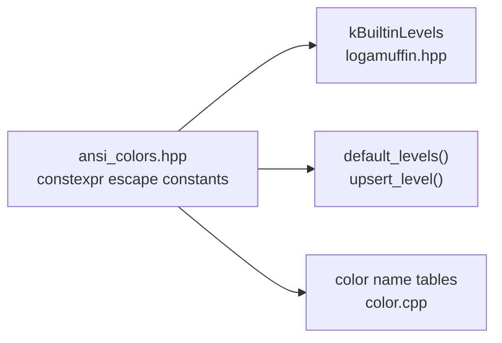

# ANSI color constants (`ansi_colors.hpp`)

Header-only table of ANSI escape sequences used throughout the logger. There is no `.cpp` counterpart; the constants are `constexpr std::string_view` at global scope.

## Contents

57 constants in families, all plain SGR escapes:

- `ANSI_RESET` — reset all attributes.
- Regular foregrounds `ANSI_BLACK` … `ANSI_WHITE` (`0;30`–`0;37`), with `ANSI_PURPLE` standing in for magenta.
- `ANSI_BOLD_*` (`1;3x`), `ANSI_UNDERLINE_*` (`4;3x`).
- `ANSI_BG_*` backgrounds (`40`–`47`).
- High-intensity variants: `ANSI_HI_*` (`0;9x`), `ANSI_BOLD_HI_*` (`1;9x`), `ANSI_BG_HI_*` (`100`–`107`).

## Where it is used

- `logamuffin.hpp` — the `kBuiltinLevels` table (built-in level name/color/value triples). See [logamuffin.cpp.md](logamuffin.cpp.md).
- `log_levels.cpp` — `default_levels()` and `upsert_level()` seed/keep colors from these constants. See [log_levels.cpp.md](log_levels.cpp.md).
- `color.cpp` — name tables map user-supplied color names onto these escapes. See [color.cpp.md](color.cpp.md).

Not included by the JSON parser, text utilities, or platform layer; file, [json_parser.cpp.md](json_parser.cpp.md), and [text_utils.cpp.md](text_utils.cpp.md) output is color-free by construction.

## Notes

Because the constants sit at global scope, they are visible to any translation unit that includes this header — keep new color spellings here rather than open-coding escapes elsewhere. The color _name_ vocabulary users can write in config files lives in [color.cpp.md](color.cpp.md), not here.

## Related pages

- [logamuffin.cpp.md](logamuffin.cpp.md) — the module whose built-in levels reference these constants
- [log_levels.cpp.md](log_levels.cpp.md) — default level registry
- [color.cpp.md](color.cpp.md) — user-facing color name resolution
- [README.md](README.md)
