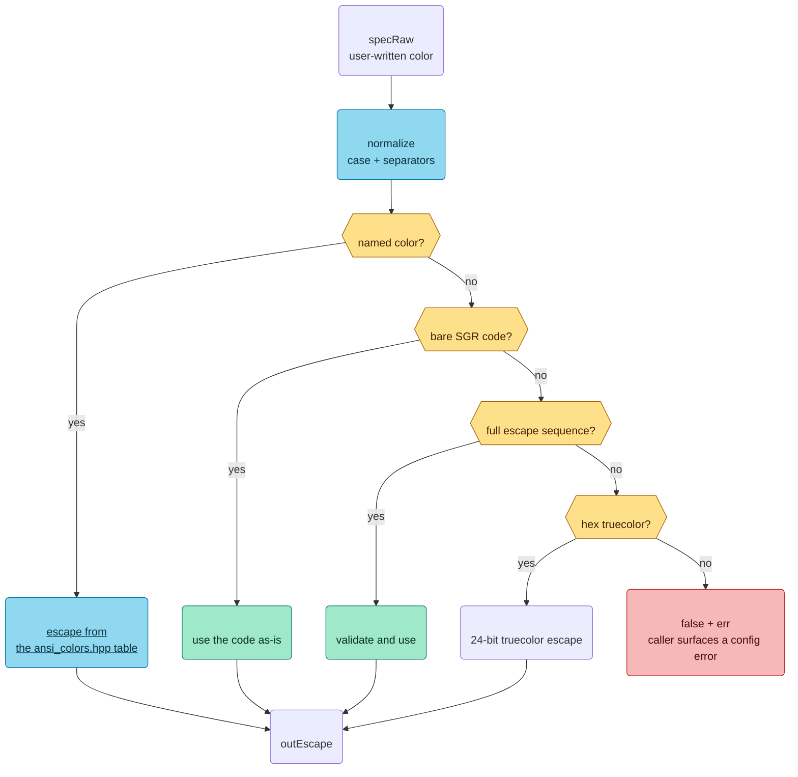

# Color resolution (`color.cpp` + `color.hpp`)



`color.cpp.md` documents `color.cpp` and `color.hpp`. The pair translates user-supplied color specifications into ANSI escape strings. Only `resolve_color()` is public; the named tables and the per-form escape resolvers are file-local in `color.cpp`. `resolve_color()` walks a fixed precedence list of form resolvers (raw ESC sequence → literal `\033`/`\e`/`\x1b` text → `[0;31m` bracket form → `#rrggbb`/`#rgb` hex → bare SGR code); the first form to claim the spec decides the outcome, and anything unclaimed falls through to the named-color table.

## Interface

```cpp
bool resolve_color(const std::string& specRaw, std::string& outEscape, std::string& err);
```

`specRaw` is resolved case-insensitively, with hyphens, underscores, and spaces treated as separators. Accepted forms:

- Named colors — every entry mirrored from [ansi_colors.hpp](ansi_colors.hpp.md) (`black`…`white`, `reset`, plus `bold-`, `underline-`, `bg-`/`background-`, `hi-`/`bright-`, `bold-hi-`, and `bg-hi-` prefixes), with `gray`/`grey` as aliases for `hi-black` and `silver` for `hi-white`.
- A bare SGR code (`"31"`, `"0;91"`).
- A full escape sequence (`"\033[0;31m"` or `"[0;31m"`).
- Hex truecolor (`"#rrggbb"` or `"#rgb"`).

Returns `false` with a short message in `err` when the specification is unknown or malformed — callers surface this as a config error rather than guessing.

## Where it is used

[config.cpp](config.cpp.md) calls `resolve_color()` while applying `LOG_LEVELS`/`LOG_LEVEL_COLOR_<NAME>` environment overrides and the JSON `levels` object, so every color path in the effective configuration funnels through this one resolver.

## Related pages

- [config.cpp.md](config.cpp.md) — the configuration pipeline that consumes resolved colors
- [ansi_colors.hpp.md](ansi_colors.hpp.md) — the escape constants named colors map onto
- [log_levels.cpp.md](log_levels.cpp.md) — where resolved colors are stored per category
- [logamuffin.cpp.md](logamuffin.cpp.md)
