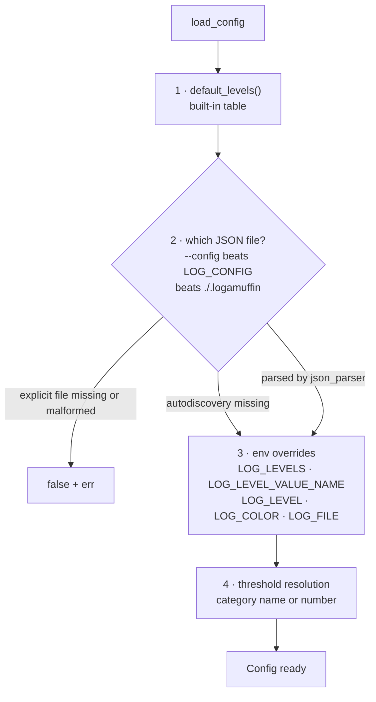

# Configuration pipeline (`config.cpp` + `config.hpp`)



`config.cpp.md` documents `config.cpp` and `config.hpp`. The module orchestrates how a [Config](log_levels.cpp.md) is built for each invocation: start from defaults, overlay the winning JSON file, overlay environment variables, then resolve scalar thresholds. Level/color/JSON primitives live in their own modules — this one only sequences them.

## Interface

```cpp
bool load_config(const std::optional<std::string>& cliConfigPath, Config& cfg, std::string& err);
```

`cliConfigPath` carries the `--config` value when present; otherwise `LOG_CONFIG`/`LOGAMUFFIN_CONFIG` and then `./.logamuffin` autodiscovery decide which file is read. An explicitly selected but missing or malformed file is an error; a missing autodiscovered file silently keeps defaults; a malformed autodiscovered file is also an error. On failure, returns `false` with a user-facing message in `err`.

## Pipeline order

1. `default_levels()` from [log_levels.cpp.md](log_levels.cpp.md).
2. The JSON file — top-level keys `level`, `color`, `file`, `source`, `levels` (plus documented aliases), parsed with the [json_parser.cpp.md](json_parser.cpp.md) module; `--config` beats `LOG_CONFIG`, which beats `./.logamuffin`.
3. Environment overrides — `LOG_LEVELS`/`LOG_CATEGORIES` (and `LOGAMUFFIN_*` equivalents), per-category `LOG_LEVEL_VALUE_<NAME>`/`LOG_LEVEL_COLOR_<NAME>` (both documented spellings), then scalars `LOG_LEVEL`, `LOG_COLOR`, `LOG_FILE`, `LOG_SOURCE`.
4. Threshold resolution — thresholds may name a category or be numeric; named thresholds resolve against the configured values.

The module is organized as small single-responsibility helpers (`parse_level_entry` splits into `split_entry_name_rest`/`parse_level_fields`; the env-override path into `apply_levels_json_env`/`apply_per_category_value`/`apply_per_category_color`; threshold resolution into `apply_env_string`), each independently followable; `load_config` itself stays a short sequence of pipeline stages.

Colors pass through [color.cpp.md](color.cpp.md)'s `resolve_color()`; integers through [text_utils.cpp.md](text_utils.cpp.md)'s strict parsers.

## Where it is used

`run()` in [logamuffin.cpp.md](logamuffin.cpp.md) calls `load_config()` once per invocation; a failure prints the message and exits with status 2.

## Related pages

- [log_levels.cpp.md](log_levels.cpp.md) — the `Config` model this module fills in
- [json_parser.cpp.md](json_parser.cpp.md) — the JSON reader used for config files
- [color.cpp.md](color.cpp.md) — color specification resolution
- [text_utils.cpp.md](text_utils.cpp.md) — shared scalar parsers
- [logamuffin.cpp.md](logamuffin.cpp.md) — the CLI entry point that calls `load_config()`
- [README.md](README.md) — user-facing configuration reference
