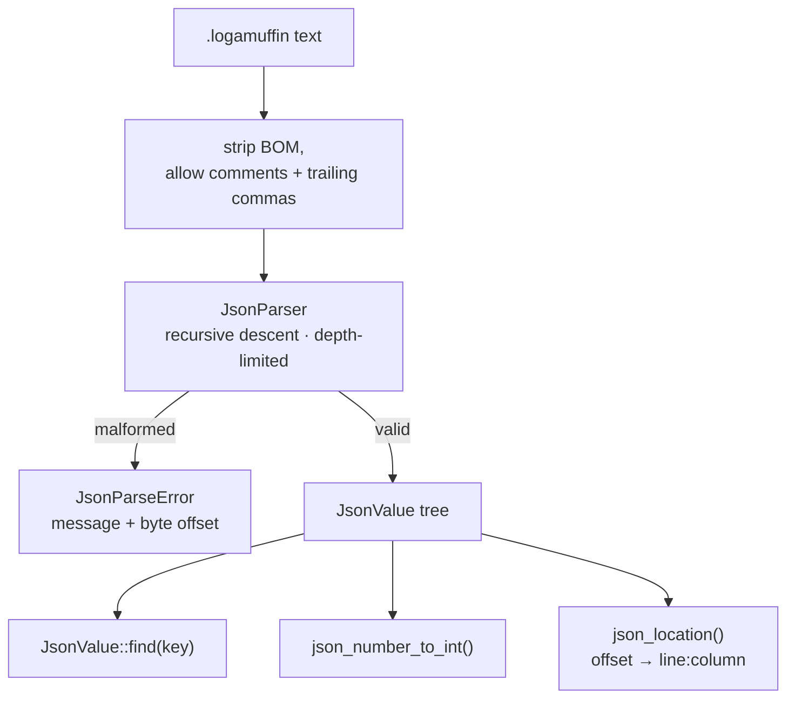

# JSON parser (`json_parser.cpp` + `json_parser.hpp`)



`json_parser.cpp.md` documents `json_parser.cpp` and `json_parser.hpp`. A minimal, dependency-free JSON reader used for `.logamuffin` config files. Config semantics live in [config.cpp.md](config.cpp.md); this module only produces a `JsonValue` tree.

## Interface

```cpp
struct JsonValue;        // Null/Bool/Number/String/Array/Object variant
struct JsonParseError;   // message + byte offset
class JsonParser {       // explicit JsonParser(std::string text); bool parse(JsonValue&, JsonParseError&); };

std::string json_location(const std::string& text, std::size_t pos);
bool json_number_to_int(const JsonValue& value, int& out);
bool json_scalar_to_int(const JsonValue& value, int& out);
```

`JsonValue::find(key)` looks up an object member (used for every top-level key in the config file). `json_location()` renders an offset as line:column for error messages.

## Supported syntax

Recursive-descent, depth-limited parser supporting objects, arrays, strings (with `\uXXXX` escapes and surrogate pairs), numbers, booleans, null, `//` and `/* */` comments, a leading UTF-8 BOM, and trailing commas — a deliberately forgiving superset of strict JSON for hand-written config files. Malformed input fails with `JsonParseError` (message plus byte offset); duplicate handling and unknown-key policy are the caller's business.

## Where it is used

[config.cpp.md](config.cpp.md) is the only consumer: it parses the selected config file and walks the resulting tree (`levels` as object or array, aliased top-level keys). Nothing else in the binary reads JSON.

## Related pages

- [config.cpp.md](config.cpp.md) — the only caller; maps `JsonValue` onto `Config`
- [text_utils.cpp.md](text_utils.cpp.md) — shares `hex_digit_value()` with the parser
- [logamuffin.cpp.md](logamuffin.cpp.md)
