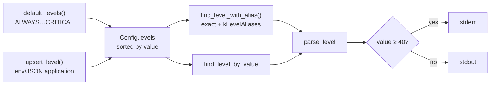

# Log level registry (`log_levels.cpp` + `log_levels.hpp`)



`log_levels.cpp.md` documents `log_levels.cpp` and `log_levels.hpp`. The extensible log-level model: `Config` holds a sorted list of `LogLevel`s plus threshold and scalar settings. This module manages the registry itself; applying config files and environment variables lives in [config.cpp.md](config.cpp.md).

## Model

```cpp
struct LogLevel { std::string name; std::string color; int value = 0; };
struct Config   { std::vector<LogLevel> levels; int thresholdValue = 20;
                  std::optional<bool> colorEnabled; std::optional<std::string> logFile, source; };
```

`kLevelAliases` is the single source of truth for `WARNING`→`WARN` and `FATAL`→`CRITICAL` (bidirectional); lookups, validation, and `parse_level()` all consult it. `kErrorLevelValueThreshold` (40) is the stderr/stdout routing value and `kMaxLevelNameLength` bounds category names.

## Key functions

- `default_levels()` — the built-in ALWAYS/TRACE/DEBUG/INFO/WARN/ERROR/CRITICAL table, colored from [ansi_colors.hpp.md](ansi_colors.hpp.md).
- `sort_levels()`, `valid_level_name()`, `find_level_exact()` / `find_level_by_value()` — ordering and lookup (exact, by alias via `find_level_with_alias()`, mutable by name).
- `ad_hoc_numeric_level(value)` — the `[25]`-style synthetic level for a number matching no configured value.
- `upsert_level()` — insert-or-override used by env/JSON application; validates names, values (via [text_utils.cpp.md](text_utils.cpp.md) limits), and colors.
- `is_error_level()`, `valid_levels_string()` — stream routing and the "valid levels are …" diagnostic.

## Where it is used

[config.cpp](config.cpp.md) builds and mutates the registry; [logamuffin.cpp.md](logamuffin.cpp.md) (`run()`/`resolve_level()`) resolves the CLI's level argument against it and routes output. `level_alias_target()` is also consulted by `parse_level()` in logamuffin_core.cpp.

## Related pages

- [config.cpp.md](config.cpp.md) — builds a `Config` from file + environment
- [logamuffin.cpp.md](logamuffin.cpp.md) — consumes the resolved levels
- [ansi_colors.hpp.md](ansi_colors.hpp.md) — colors for the built-in defaults
- [color.cpp.md](color.cpp.md) — color escapes stored on each `LogLevel`
