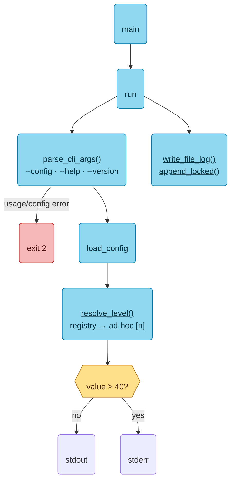

# The logamuffin module (`logamuffin.cpp` + `logamuffin.hpp` + `logamuffin_core.cpp`)

`logamuffin.cpp.md` documents `logamuffin.cpp`, `logamuffin.hpp`, and `logamuffin_core.cpp` — the executable's entry point and the pure, testable helpers behind it. `logamuffin.hpp` holds declarations, the `Level` model, the `kBuiltinLevels` table, and shared constants; `logamuffin_core.cpp` implements the pure logic; `logamuffin.cpp` owns CLI parsing, I/O, and `main()`.

## `logamuffin.hpp` / `logamuffin_core.cpp` — testable core

`Level` (Always=-1 … Critical=50), `LevelInfo`, `kBuiltinLevels`, and `kFullFormatWidth`/`kMediumFormatWidth` (180/120) live here so both the executable and `tests/unit/test_logamuffin.cpp` see one interface. Implemented: `uppercase()`, `basename()`, `env_enabled()`, `parse_level()` (name/alias/numeric), `info()`, `timestamp()`, `clean_message()`, `get_source()`, `should_emit()`, `join_message()`, and the `format_file_entry()` / `format_console_output()` pairs (`Level`-enum forms delegating to the canonical `LogLevel` forms, so custom categories render identically). Non-TTY (captured) output always uses `kFullFormatWidth`.

## `logamuffin.cpp` — CLI and I/O

`main()` → `run()`: parses `--config`/`--help`/`--version` and `LEVEL MESSAGE…` (`parse_cli_args()`), calls [config.cpp.md](config.cpp.md)'s `load_config()`, resolves the level argument against the registry (`resolve_level()`, falling back to `[<n>]` ad-hoc levels for unknown numbers), then `emit_console_line()` (stdout below value 40, stderr at/above) and `write_file_log()` (append via [platform.cpp.md](platform.cpp.md)'s `append_locked()`). `--help`/`--version`/`--config` exit codes: usage/config errors exit 2. Both `--config` positions (leading options and immediately after LEVEL) are handled by one shared `apply_config_flag()` helper, so the two sites cannot drift apart.

## Where it is used

This _is_ the `logamuffin` binary (compiled from `SOURCES` in `tools/sources.sh.md`). Shell scripts log through it directly or via [scripts/log.sh.md](scripts/log.sh.md); tests exercise it from `scripts/run_tests.sh`.

## Related pages

- [config.cpp.md](config.cpp.md) — configuration loading used by `run()`
- [log_levels.cpp.md](log_levels.cpp.md) — the registry `resolve_level()` consults
- [platform.cpp.md](platform.cpp.md) — hostname/TTY/width/locked-append helpers
- [scripts/log.sh.md](scripts/log.sh.md) — the Bash `log` wrapper around this binary
- [scripts/run_tests.sh.md](scripts/run_tests.sh.md) — how the module is built and tested
- [README.md](README.md) — user-facing documentation
