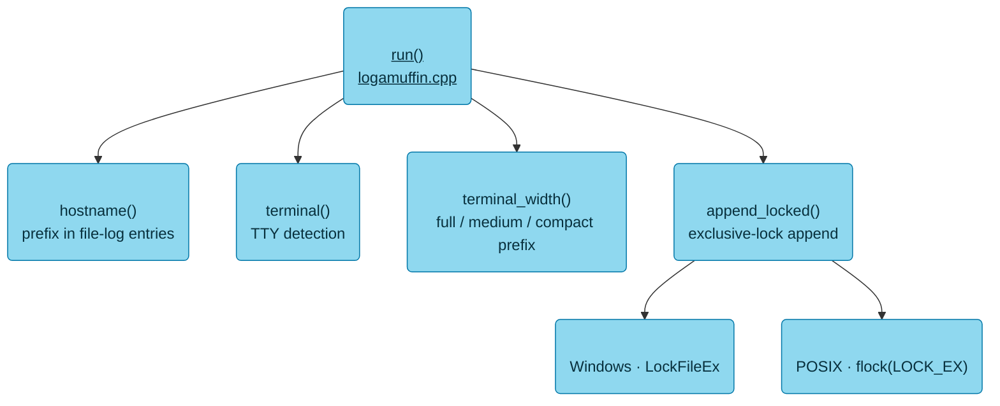

# Platform layer (`platform.cpp` + `platform.hpp`)



`platform.cpp.md` documents `platform.cpp` and `platform.hpp`. The only module that touches OS-specific APIs — Windows vs POSIX — so everything else stays pure and portable.

## Interface

```cpp
std::string hostname();
bool terminal(FILE* stream);
int terminal_width();
bool append_locked(const std::filesystem::path& path, const std::string& entry);
```

- `hostname()` — machine name embedded in file-log entries and console prefixes.
- `terminal(FILE*)` — TTY detection (drives color auto-detection and the width-sensitive console format).
- `terminal_width()` — console width used to pick full/medium/compact prefixes in [logamuffin.cpp.md](logamuffin.cpp.md).
- `append_locked(path, entry)` — appends one preformatted line to the log file under an exclusive lock, so concurrent `logamuffin` processes do not interleave writes. Returns `false` on open/lock/write/close failure; `run()` reports that as a warning without failing the log call.

## Where it is used

`run()` in [logamuffin.cpp.md](logamuffin.cpp.md) is the only caller — for hostname/width/TTY during output formatting and for the persistent file log (`LOG_FILE`, default `.logs/log.log`).

## Notes

No tests stub this module directly; the CLI integration suite in `tests/integration/test_cli.py` covers the observable behavior (streams, files, exit codes) end to end. Unit tests ([scripts/run_tests.sh.md](scripts/run_tests.sh.md)) deliberately stay off platform APIs.

## Related pages

- [logamuffin.cpp.md](logamuffin.cpp.md) — the caller
- [config.cpp.md](config.cpp.md) — `LOG_FILE` handling feeds `append_locked()`
- [README.md](README.md)
