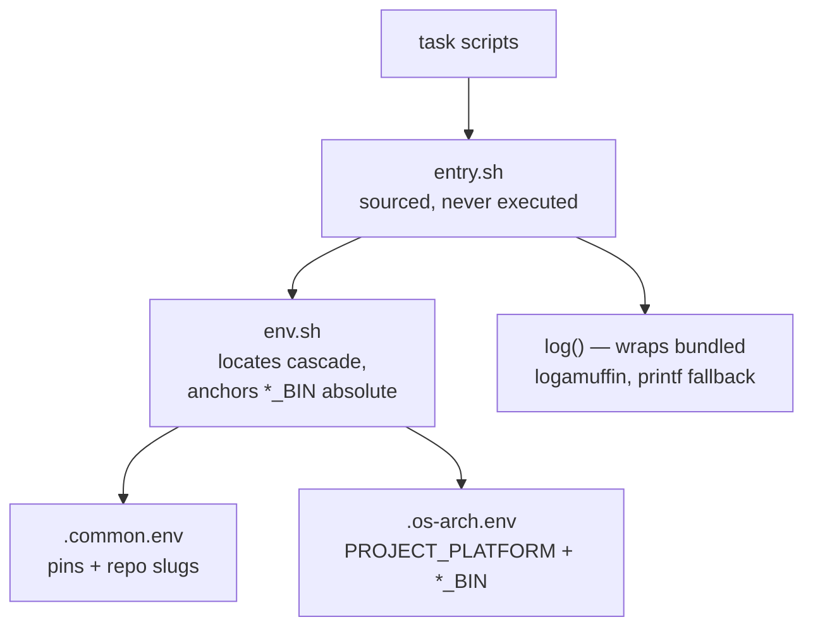

# Repository script tooling (`scripts/`)

The `scripts/` directory carries the repository's build/release/docs tooling: an environment cascade the other scripts source, plus one entry point per task. Everything here is bash; nothing requires a global install beyond what each script documents.

Vernacular used in the headers (`log INFO`, `$REPO_ROOT_DIR`, `VERSIONER_BIN`): read [entry.sh.md](entry.sh.md) first, then [env.sh.md](env.sh.md).

## The cascade (why the dotfiles exist)

- `scripts/entry.sh` — sources `scripts/env.sh` and defines `log()` (logamuffin, with a printf fallback). Sourced by everything else. See [entry.sh.md](entry.sh.md).
- `scripts/env.sh` — locates and sources the cascade below, then anchors the repository-relative `*_BIN` tool paths to absolute paths. See [env.sh.md](env.sh.md).
- `scripts/.common.env`, `scripts/.<os>-<arch>.env` — the cascade proper. Hidden files, so barnacle does not render them as pages; their contract (pinned versions, platform quirks) is documented inside [env.sh.md](env.sh.md) instead. `.common.env` pins `VERSIONER v0.0.3.0.5`, `LOGAMUFFIN v254.1.3.0.47`, `RUNNER_SPAWNER v0.0.1.2.6`, `BARNACLE v254.0.1.1.22` and holds the upstream `fordaj/*` slugs; each platform file sets `PROJECT_PLATFORM` and the `*_BIN` paths for its `<os>-<arch>`.

## Task scripts

- [build.sh](build.sh.md) — cross-compile the six release targets (Zig + native clang++) into `build/<mode>/<platform>/`.
- [format.sh](format.sh.md) — format the repository in place with formattington.
- [demo.sh](demo.sh.md) — scripted demo of every capability in one pass.
- [log.sh](log.sh.md) — the Bash `log` helper: sourced by scripts to get `log LEVEL msg` with automatic `LOG_SOURCE` tracking.
- [run_tests.sh](run_tests.sh.md) — the one-command test entry point (doctest unit tests + Python CLI integration suite).
- [test.sh](test.sh.md) — deprecated shim forwarding to `run_tests.sh --skip-unit`.
- [release.sh](release.sh.md) — version, cross-compile, pack archives, tag, and publish the GitHub release.
- [version.sh](version.sh.md) — print the repository version computed by versioner (`--format text|shell|json`).
- [docs.sh](docs.sh.md) — generate the documentation site you are reading, with the bundled barnacle.
- [entry.sh.md](entry.sh.md) / [env.sh.md](env.sh.md) — the sourced cascade and `log()` helper (not entry points).

`ci/format_check.sh` at `ci/` is the check-only counterpart of [format.sh](format.sh.md) used by CI.

## Related pages

- `tools/README.md` — the bundles selected by the `*_BIN` variables
- [../AGENTS.md](../AGENTS.md)
- [../README.md](../README.md)
