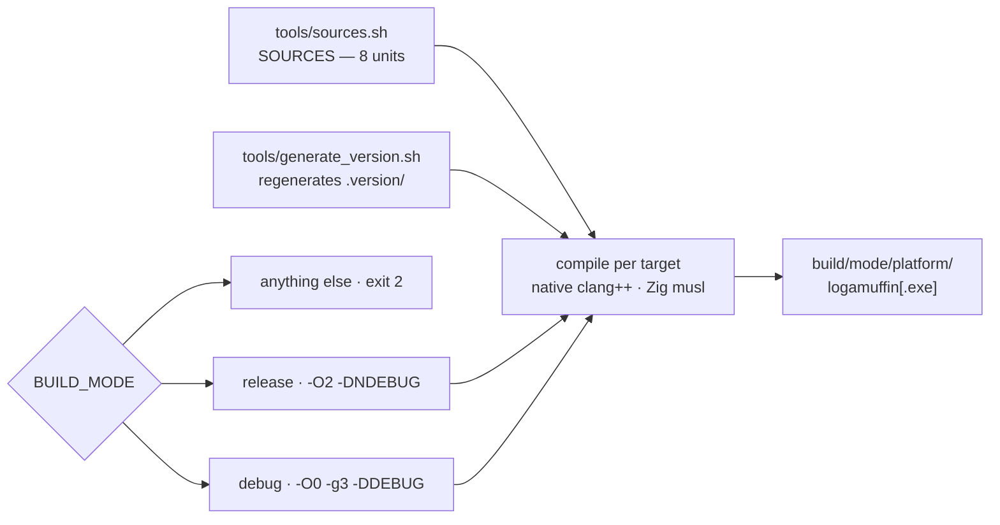

# Cross-platform build (`scripts/build.sh`)



`scripts/build.sh` builds the six release targets: macOS x86-64 and arm64 (native `clang++`), and Windows x86-64/arm64 + Linux x86-64/arm64 (musl) via Zig (`zig c++ -target …`). Mode comes from `BUILD_MODE` — `release` (default, `-O2 -DNDEBUG`) or `debug` (`-O0 -g3 -DDEBUG`); anything else exits 2. Native compiler can be overridden with `NATIVE_CXX`, Zig with `ZIG_CXX`, and clean rebuilds with `CLEAN_BUILD=false`.

## What it does

1. `cd`s to the repo root and sources `tools/sources.sh.md` for the translation-unit list.
2. Regenerates `.version/version.hpp` via `tools/generate_version.sh.md` so `--version` always reflects `HEAD` (`.version/` is git-ignored).
3. Compiles each target into `build/<mode>/<platform>/logamuffin[.exe]` — release and debug outputs never collide, and the repo root stays clean.

```bash
BUILD_MODE=debug scripts/build.sh
BUILD_MODE=release scripts/build.sh
```

Consumers: `scripts/release.sh` builds release targets through this script; [../demo.sh.md](demo.sh.md) and `scripts/log.sh` look for binaries under `build/<mode>/<platform>/`.

## Outputs

`build/<mode>/macos-x86_64/`, `…/macos-arm64/`, `…/windows-x86_64/`, `…/windows-arm64/`, `…/linux-x86_64/`, `…/linux-arm64/`, each holding `logamuffin[.exe]`. `build/` is git-ignored.

## Related pages

- `tools/sources.sh.md` — the `SOURCES` array compiled here
- `tools/generate_version.sh.md` — version header regeneration
- [release.sh.md](release.sh.md) — packages these binaries into release archives
- [../README.md](../README.md) — "Building from source"
