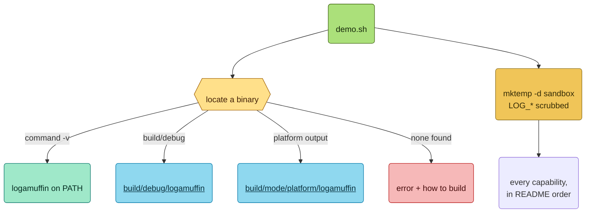

# Feature demo (`scripts/demo.sh`)



`scripts/demo.sh` is a self-contained showcase of every user-facing capability documented in [README.md](../README.md): version/help, severity levels and colors, aliases and numeric levels, threshold filtering, stdout vs stderr routing, the environment surface, custom categories, JSON config and precedence, persistent file logging, concurrent writes, shell patterns, and the Bash `log` helper. Section order follows the README.

## Running it

```bash
./scripts/demo.sh
```

There is intentionally no `set -e`: several sections trigger expected failures (unknown level, bad config) to show exit codes, so aborting on error would defeat the demo.

The script locates a `logamuffin` binary by `command -v`, then `build/debug/logamuffin` (the [scripts/run_tests.sh.md](run_tests.sh.md) output), then `build/{release,debug}/<platform>/logamuffin[.exe]` (the [scripts/build.sh.md](build.sh.md) output; the platform name comes from the shared `tools/host_platform.sh` helpers). If none is found it exits with an error explaining how to build one.

Demo state is isolated: host `LOG_*`/`LOGAMUFFIN_*` variables are unset up front and output goes to a `mktemp -d` directory that is removed on exit, so running the demo never touches your tree or your real `.logs/log.log`.

Re-run it after any change to compare outputs for regressions; the README's `image.png` is a capture of a demo run.

## Related pages

- [README.md](../README.md) — the user documentation the demo mirrors
- [scripts/log.sh.md](log.sh.md) — the `log` helper demonstrated in the final sections
- [scripts/run_tests.sh.md](run_tests.sh.md) — builds `build/debug/logamuffin` used by the demo
- [scripts/build.sh.md](build.sh.md) — builds the per-platform binaries
