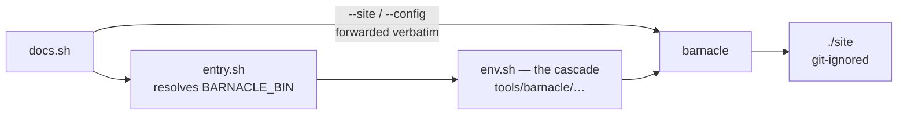

# The docs generator (`scripts/docs.sh`)



Generates the documentation site you are reading: it runs the pinned barnacle binary against this repository (the bundle is refreshed by `tools/barnacle/update.sh`, documented in `tools/barnacle/update.sh.md`).

Barnacle scans the working tree for Markdown (`.md`) and Mermaid (`.mmd`) files, renders each as a page, and keeps relative links between them. Generated output is static HTML; it is written to `./site/` by default and is never committed (it is in `.gitignore`).

## Usage

```bash
scripts/docs.sh                       # generate into ./site/
scripts/docs.sh --site ./public       # forward --site to barnacle
scripts/docs.sh --config ./docs/barnacle.json
scripts/docs.sh --help                # usage for this script
```

Any arguments other than `--help`/`-h` are forwarded to barnacle verbatim; see `barnacle --help` for `--config`/`--site` semantics.

## How it locates barnacle

Sources [entry.sh.md](entry.sh.md); `BARNACLE_BIN` comes from the [cascade](env.sh.md) (`tools/barnacle/v<version>/<platform>/barnacle[.exe]`). If the bundle is missing or not executable, the script fails with instructions to run `tools/barnacle/update.sh` (or set `BARNACLE_BIN` explicitly). It then runs barnacle with the repository root as the working directory, so barnacle's `./.barnacle.json` (committed: title `logamuffin`, excluding `tools`, `dist`, `build`, and `agents`) and its default `./site/` output land at the repository root regardless of the caller's cwd.

## What the site contains

Every `.md`/`.mmd` outside the `.barnacle.json` exclusions — see the [root README](../README.md) and [AGENTS.md](../AGENTS.md). `.git`, `node_modules`, `vendor`, and `dist` are always excluded by barnacle; hidden files and directories (the cascade's `.common.env` et al.) are skipped by default; `tools/`, `build/`, and `agents/` are excluded by `.barnacle.json`.

Every documented source file has a sibling `.md` page — see the "Documentation files (barnacle)" section in [../AGENTS.md](../AGENTS.md).

## Related pages

- `tools/barnacle/update.sh.md` — the pinned binaries and how to refresh them
- [entry.sh.md](entry.sh.md) · [env.sh.md](env.sh.md)
- [../AGENTS.md](../AGENTS.md)
