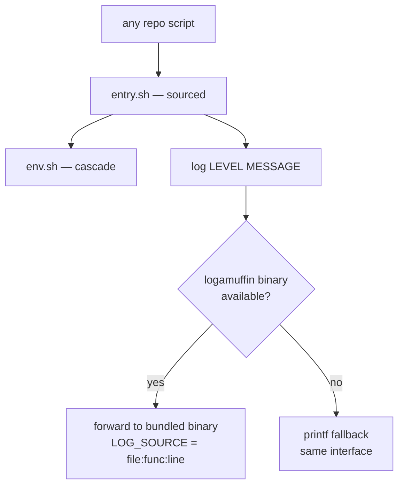

# The script entry point (`scripts/entry.sh`)

`scripts/entry.sh` is sourced — never executed — by the repo's tooling scripts. It sources [env.sh.md](env.sh.md) (locating the pinned tool binaries) and defines `log()`, the repo-internal logging helper used by those scripts' headers.

## What `log()` does

`log LEVEL [MESSAGE …]` forwards everything to the bundled logamuffin (`$LOGAMUFFIN_BIN` from the cascade) with `LOG_SOURCE` set from the call site (`file[:function]:line`, function omitted for top-level and `main`). The exit code is preserved (`0` success/filtered, `2` usage/config errors), even under `set -e`.

If the logamuffin binary is missing or not executable — a fresh clone before `tools/logamuffin/update.sh` is run — `log()` falls back to `_fallback`, a printf implementation with the same call shape: level filtering against `LOG_LEVEL`/`LOGAMUFFIN_LEVEL` (default `INFO`), `40+` to stderr, and exit code `2` only for a missing level argument. The call-site `LOG_SOURCE` is computed by `_caller_source`, which reports the file/function/line one frame above `log()` via the `BASH_SOURCE`/`FUNCNAME`/`BASH_LINENO` arrays and exports it as `CALLER_SOURCE` (a global, so no command-substitution subshell frame shifts the arithmetic). Word-to-number mapping (and numeric pass-through) lives in `_level_to_value`. This keeps bootstrap scripts usable before the bundles are present.

Note: this is the repo-internal variant. The user-facing `log` Bash helper shipped for other projects lives in [../log.sh.md](log.sh.md) (`scripts/log.sh` at the repo root) and additionally falls back to `PATH`/build outputs.

## Vernacular seen in script headers

Comments like `# Logging uses log <level> <message> from scripts/entry.sh` refer to this file; `$REPO_ROOT_DIR`, `$VERSIONER_BIN`, etc. come from [env.sh.md](env.sh.md).

## Related pages

- [env.sh.md](env.sh.md) — the environment cascade this sources
- [README.md](README.md) — the hub for the scripts directory
