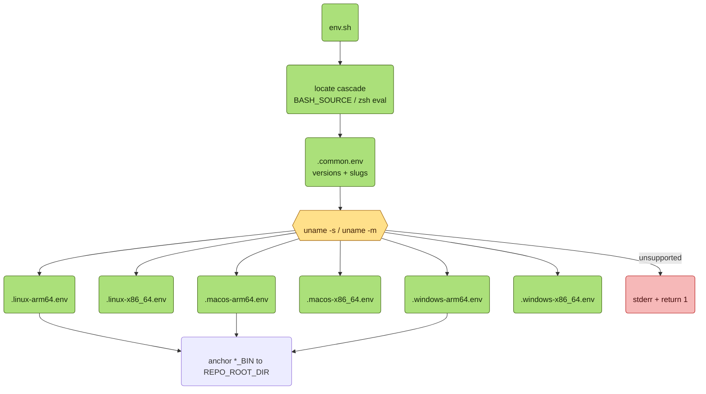

# The environment cascade (`scripts/env.sh` + the hidden `.*.env` files)

`scripts/env.sh` is the plumbing that makes the pinned helper tools resolvable from any script, in any working directory, on every supported platform. It is sourced — never executed — and it works from both bash and zsh.

## What it does

1. Locates the cascade files relative to itself (bash via `$BASH_SOURCE`, zsh via `$ZSH_VERSION` with an `eval` so POSIX parsers never see the `${(%):-%x}` syntax) so sourcing works from any cwd.
2. Brings in `.common.env`, then the platform file selected by `uname -s`/`uname -m` — for example `.macos-arm64.env` or `.windows-x86_64.env` (Windows matched via `MINGW*`/`MSYS*`/`CYGWIN*`). Unsupported platforms print an error to stderr and return `1`.
3. **Anchors** every repository-relative `*_BIN` to the repository root (`REPO_ROOT_DIR`), leaving absolute paths untouched. After sourcing, `$VERSIONER_BIN`, `$LOGAMUFFIN_BIN`, `$RUNNER_SPAWNER_BIN`, and `$BARNACLE_BIN` are absolute.
4. Sets `REPO_ROOT_DIR` for callers that need the repository root (for example [version.sh.md](version.sh.md)).

Everything is exported with `set -a` while sourcing and un-exported afterwards, so the cascade does not leak into the caller's environment beyond the intended variables.

## The hidden files

Hidden files are excluded from barnacle's default scan, so their contract is documented here (see the "Documentation files (barnacle)" section in [../AGENTS.md](../AGENTS.md)):

- **`.common.env`** — `TOOLS_DIR=tools`; the upstream `fordaj/*` repository slugs; `.versioner.json` as the Versioner config; the pinned `*_VERSION_DIR`s: `VERSIONER_VERSION_DIR=tools/versioner/v0.0.3.0.5`, `LOGAMUFFIN_VERSION_DIR=tools/logamuffin/v254.1.3.0.47`, `RUNNER_SPAWNER_VERSION_DIR=tools/runner-spawner/v0.0.1.2.6`, `BARNACLE_VERSION_DIR=tools/barnacle/v0.0.2.1.25`. When bumping a pinned tool, this file names the version directory the platform files point into.
- **`.<platform>.env`** — one per supported platform (`linux-arm64`, `linux-x86_64`, `macos-arm64`, `macos-x86_64`, `windows-arm64`, `windows-x86_64`). Sets `PROJECT_PLATFORM` and the `*_BIN` paths (with `.exe` on Windows). Platform quirks recorded in the files themselves: Linux `runner-spawner` reports unsupported (macOS + Windows only) even though the binary is shipped for a uniform layout; and `windows-arm64` has no upstream versioner bundle — `VERSIONER_BIN` points at the `windows-x86_64` build with an explicit note to set `VERSIONER_BIN` to a versioner on `PATH` if that is wrong for the host.

## Related pages

- [entry.sh.md](entry.sh.md) — the entry point most scripts source (it loads this file and defines `log()`)
- [docs.sh.md](docs.sh.md) — the docs generator that resolves `BARNACLE_BIN` through this cascade
- `tools/README.md` — the bundles selected by the `*_BIN` variables
