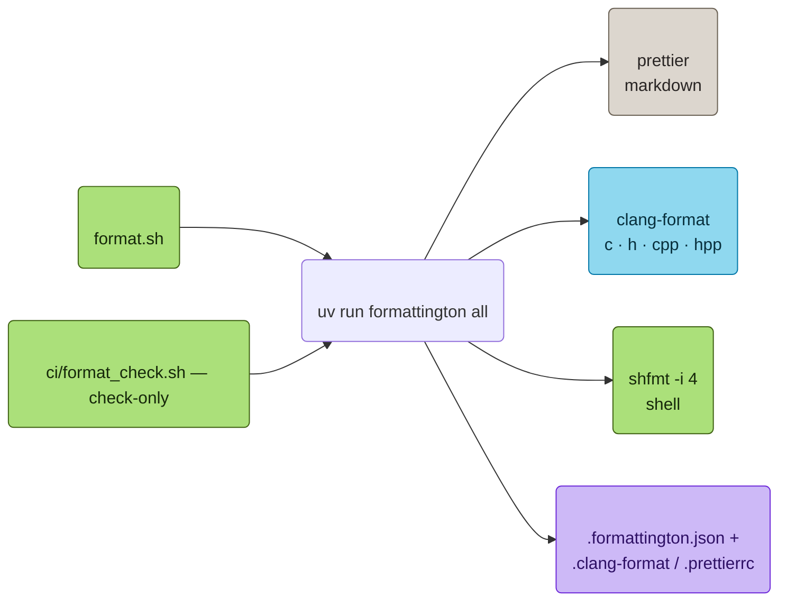

# Formatting in place (`scripts/format.sh`)



`scripts/format.sh` formats the whole repository with [formattington](https://github.com/fordaj/formattington): Markdown via prettier, C/C++ via clang-format, shell via `shfmt -i 4`, as scoped by `.formattington.json` and styled by `.clang-format`/`.prettierrc`. The vendored header under `tools/doctest/` is skipped (as are `build/` and other generated locations).

## Usage

```bash
./scripts/format.sh              # format everything in place
./scripts/format.sh --series     # format sequentially (ordered output)
./scripts/format.sh --verbose    # show which formatter executables were resolved
```

Extra flags are forwarded to `formattington` before `all`. `--config` is managed by the script and must not be passed. CI uses the check-only counterpart `ci/format_check.sh` (same config, `--check`); see "Formatting" in [README.md](../README.md).

## Prerequisites and pinning

- `uv` (https://docs.astral.sh/uv/) — the script `exec`s `uv run formattington …`; formattington itself is pinned in `pyproject.toml` / `uv.lock` and runs on Python 3.14 (see `.python-version`). `uv run` creates `.venv/` automatically.
- `prettier`, `clang-format`, `shfmt` on `PATH` (formattington exits 127 if one is missing).

To bump formattington, update the commit in `pyproject.toml` and run `uv lock` and `uv sync`.

## Related pages

- [README.md](../README.md) — "Formatting" section
- [AGENTS.md](../AGENTS.md) — repository layout and formatting conventions
