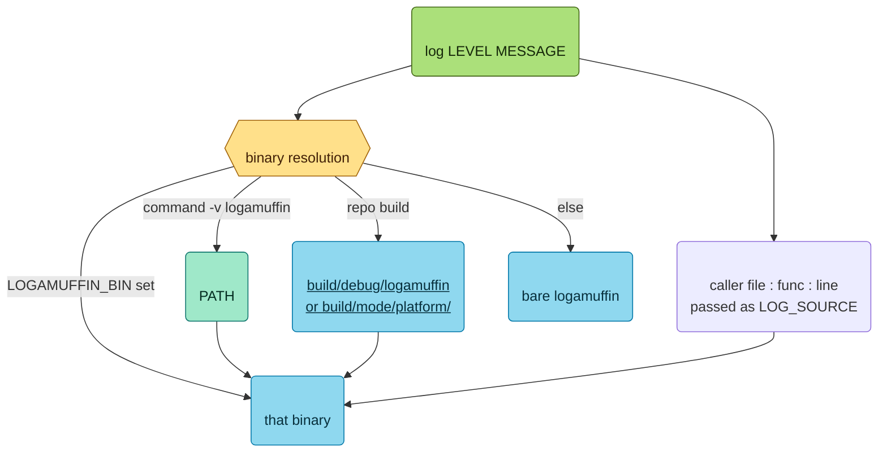

# The Bash `log` helper (`scripts/log.sh`)



`scripts/log.sh` defines a `log LEVEL [MESSAGE …]` Bash function that wraps the `logamuffin` executable so call sites stay terse: `log INFO "Starting"` instead of `logamuffin INFO "Starting"`. It resolves the caller's file, function, and line number and passes them to `logamuffin` as `LOG_SOURCE` (e.g. `my-script.sh:myfunc:42`), forwards `LEVEL` (a word such as `INFO` or a number such as `50`) and the message verbatim, and preserves `logamuffin`'s exit code.

## Install

```bash
source /path/to/log.sh   # or source ./scripts/log.sh from this repo
log INFO "Application started"
```

The function is also inlined in [README.md](../README.md) ("Bash helper"); the copy there is identical.

## Behavior notes

- Binary resolution happens at call time: `LOGAMUFFIN_BIN` if set, else `command -v logamuffin`, else the repo-local `build/debug/logamuffin` or `build/release/macos-arm64/logamuffin` if executable, else bare `logamuffin` on `PATH`.
- `LOG_LEVEL`, `LOG_FILE`, `LOG_COLOR`, `LOG_CONFIG`, `LOG_LEVELS`, and friends are inherited unchanged — export them once per script and `log` respects them. `LOG_SOURCE` is the exception: it is always set per call from the call site.
- Bash only (`BASH_SOURCE`/`FUNCNAME`/`BASH_LINENO`). For Zsh, capture the call site with `${(%):-%N}` / `$LINENO` instead — see README.

This is distinct from `scripts/entry.sh`'s `log()`, which is the same idea for this repository's own scripts (with a printf fallback when no binary is available); see [scripts/entry.sh.md](entry.sh.md).

## Related pages

- [logamuffin.cpp.md](../logamuffin.cpp.md) — the binary this wraps
- [scripts/entry.sh.md](entry.sh.md) — the repo-internal `log()` used by tooling
- [scripts/demo.sh.md](demo.sh.md) — demonstrates the helper end to end
- [README.md](../README.md)
