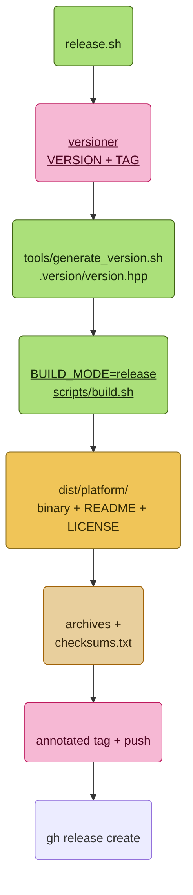

# The release pipeline (`scripts/release.sh`)



`scripts/release.sh` computes the next version with the bundled Versioner binary, regenerates `.version/version.hpp`, cross-compiles the release binaries via [build.sh.md](build.sh.md), packs each platform into a flat archive (binary + `README.md` + `LICENSE`), tags `HEAD`, and publishes a GitHub release. Adapted from fordaj/Versioner's release script — same concept, Zig instead of Go.

## Usage

```bash
scripts/release.sh           # tag + push + GitHub release
scripts/release.sh --dry-run # compute + build only, touch nothing remote
```

`--dry-run` (`-n`) still computes the version and builds; it skips the tag/push/release steps.

## Prerequisites

`zig`, `git`, `tar`, `zip`, and — for a real release — `gh` authenticated via `gh auth login`. The working tree must be clean (warning only under `--dry-run`); `HEAD` should be pushed.

## What it does

1. Computes `VERSION`/`TAG` with the bundled `tools/versioner/v*/<platform>/versioner` (host detection and bundled-binary resolution shared via `tools/host_platform.sh`; override with `VERSIONER_BIN`); validates `TAG` against `vX.Y.Z.W.V`.
2. Refuses to run if `TAG` already exists locally or on `origin` (make a new `feat:`/`fix:` commit to bump the version).
3. Regenerates `.version/version.hpp` via `tools/generate_version.sh.md` and checks it contains `LOGAMUFFIN_VERSION_TAG "$TAG"`.
4. Runs `BUILD_MODE=release scripts/build.sh`; stages `dist/<platform>/` with binary + `README.md` + `LICENSE`; sanity-checks the native binary's `--version`.
5. Packs `dist/Logamuffin_<TAG>_<platform>.tar.gz` (`.zip` on Windows via `zip -j`), writes `dist/checksums.txt` (`shasum -a 256` or `sha256sum`).
6. Creates an annotated tag, pushes it, and creates the GitHub release with the archives + checksums. Under `--dry-run` it prints what it would do instead.

`dist/` is git-ignored.

## Related pages

- [build.sh.md](build.sh.md) — produces `build/release/<platform>/`
- [version.sh.md](version.sh.md) — read-only version printing via the same binary
- `tools/versioner/update.sh.md` — refresh the bundled versioner
- `tools/generate_version.sh.md` — version header regeneration
- `tools/host_platform.sh.md` — shared host/versioner helpers sourced by this script
- [../README.md](../README.md) — "Building from source" / release notes
