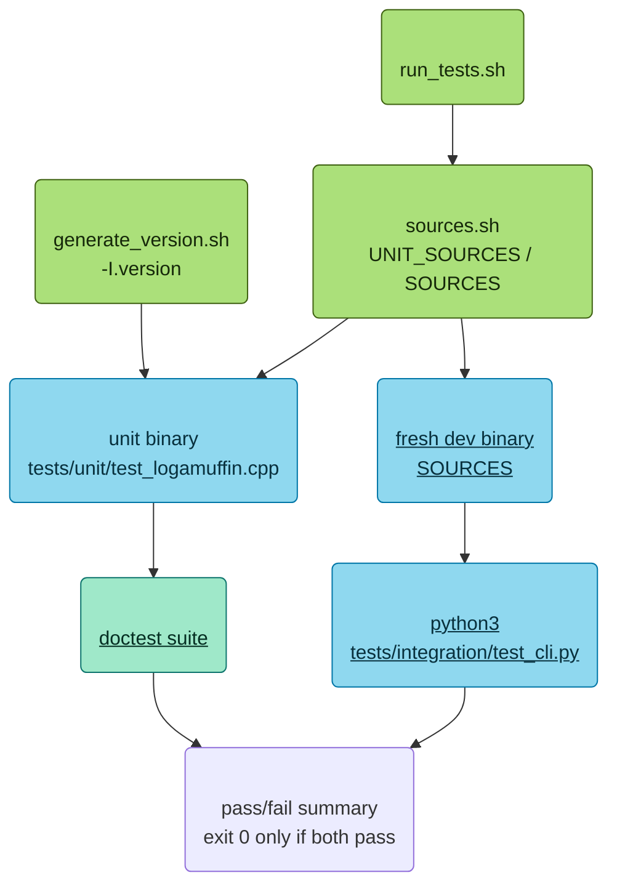

# Test runner (`scripts/run_tests.sh`)



`scripts/run_tests.sh` builds and runs the complete logamuffin test suite — C++ unit tests (doctest) and cross-platform CLI integration tests (Python standard library) — and is the one command CI and contributors use. See [docs/TESTING.md](../docs/TESTING.md) for the testing architecture, coverage matrix, and how to add tests.

## Usage

```bash
./scripts/run_tests.sh                      # full suite (fresh dev build)
./scripts/run_tests.sh --skip-unit          # integration only
./scripts/run_tests.sh --skip-integration   # unit only
./scripts/run_tests.sh --clean              # remove previous test outputs first
./scripts/run_tests.sh --executable ./build/release/macos-arm64/logamuffin  # test a release binary
./scripts/run_tests.sh --verbose            # verbose integration output
```

Exit code is `0` only if both suites pass; individual failures are reported without stopping the suite.

## How it works

1. Sources `tools/sources.sh.md` for the translation-unit list and native toolchain (`clang++`, falling back to `c++`; override with `CXX`).
2. Regenerates `.version/version.hpp` via `tools/generate_version.sh` so the unit binary and dev binary include `version.hpp` with `-I.version`.
3. Builds the unit-test binary from `tests/unit/test_logamuffin.cpp` + `UNIT_SOURCES` against `tools/doctest/v2.5.3/doctest.h` (see `tools/doctest/README.md`), runs it.
4. Builds a fresh native dev binary from `SOURCES` (or uses `--executable`), then runs `tests/integration/test_cli.py` against it. The integration suite can also target any binary directly via `LOG_BIN=/path/to/logamuffin python3 tests/integration/test_cli.py`.

Requirements: a C++20 compiler, Python 3 (stdlib only), Bash — and the vendored doctest header (checked for explicitly).

## Related pages

- [docs/TESTING.md](../docs/TESTING.md) — testing architecture and conventions
- [scripts/test.sh.md](test.sh.md) — deprecated shim forwarding here with `--skip-unit`
- `tools/sources.sh.md` — `SOURCES`/`UNIT_SOURCES` used here
- `tools/generate_version.sh.md` — version header regeneration
- [README.md](../README.md) — "Testing" section
