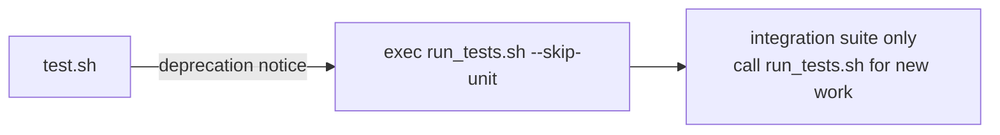

# Deprecated test shim (`scripts/test.sh`)



`scripts/test.sh` is a deprecated shim kept for compatibility. The canonical suite is [scripts/run_tests.sh.md](run_tests.sh.md) (`./scripts/run_tests.sh`, unit + integration); the Python CLI integration suite supersedes this legacy Bash suite with isolated tmp dirs, per-test reporting, and broader coverage.

## What it does

Prints a deprecation notice to stderr, then `exec`s `scripts/run_tests.sh --skip-unit "$@"` — i.e. only the CLI integration suite, with the same exit code.

```bash
./scripts/test.sh    # == ./scripts/run_tests.sh --skip-unit
```

New work should call `./scripts/run_tests.sh` (or `tests/integration/test_cli.py` directly) rather than this wrapper.

## Related pages

- [scripts/run_tests.sh.md](run_tests.sh.md) — the canonical entry point
- [docs/TESTING.md](../docs/TESTING.md) — testing architecture
- [README.md](../README.md)
