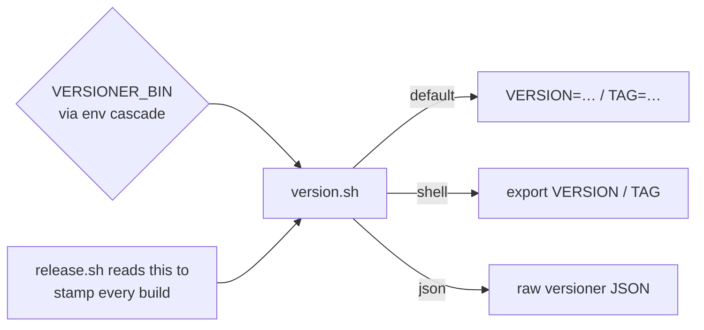

# Printing the repository version (`scripts/version.sh`)



`scripts/version.sh` prints the version of the repository as computed by `tools/versioner/update.sh.md`, so the version of a build and the version of a release can never drift apart. It is sourced-independent: it loads [entry.sh.md](entry.sh.md) itself and works from any cwd.

## Usage

```bash
scripts/version.sh                 # VERSION=<v> and TAG=<t> lines (default)
scripts/version.sh --format text   # same as default
scripts/version.sh --format shell  # export VERSION=... and export TAG=...
scripts/version.sh --format json   # raw json from versioner
```

Unknown arguments and unknown `--format` values exit 2; a missing/unexecutable `VERSIONER_BIN` exits 1 with instructions to run `tools/versioner/update.sh`.

## How it resolves the binary

`VERSIONER_BIN` (via the [env cascade](env.sh.md)) or `VERSIONER_REPO_DIR` (defaults to the repository root) are the knobs. The `json` format delegates to `versioner --quiet --format json`; the `text`/`shell` formats parse the `VERSION=`/`TAG=` lines from its output and fail with exit 1 if either cannot be parsed. `.versioner.json` at the repo root configures the five-part version scheme (see "Versioning" in [../README.md](../README.md)).

## Related pages

- [env.sh.md](env.sh.md) — where `VERSIONER_BIN` comes from
- `tools/versioner/update.sh.md` — the bundled binary and how to refresh it
- [release.sh.md](release.sh.md) — releases using the same computation
- [README.md](README.md)
