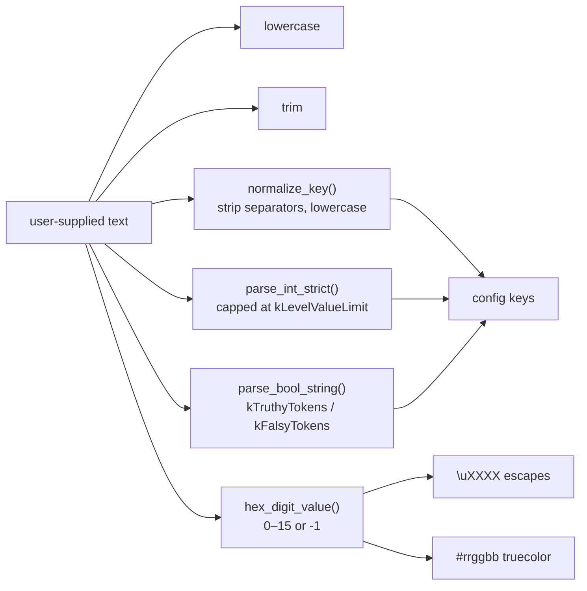

# Text utilities (`text_utils.cpp` + `text_utils.hpp`)



`text_utils.cpp.md` documents `text_utils.cpp` and `text_utils.hpp`. Small, pure string/number helpers shared by the config, color, and JSON modules so each can depend on them explicitly instead of sharing an anonymous namespace. No I/O, no platform dependencies.

## Interface

```cpp
std::string lowercase(std::string s);
std::string trim(const std::string& s);
std::string normalize_key(const std::string& s);   // strip separators, lowercase
bool parse_int_strict(const std::string& raw, int& out);
bool parse_bool_string(const std::string& raw, bool& out);
int hex_digit_value(char c);                        // 0-15 or -1
```

`normalize_key()` makes `log_level`, `log-level`, and `loglevel` equivalent config keys. `parse_int_strict()` accepts an optional sign and digits only, rejecting empty/malformed input and magnitudes above `kLevelValueLimit` (1,000,000) — it is the single numeric gate for level values from env/JSON/CLI. `parse_bool_string()` honours the shared `kTruthyTokens`/`kFalsyTokens` tables (`1/TRUE/YES/ON`, `0/FALSE/NO/OFF`) single-sourced in `text_utils.hpp` (also used by `env_enabled()` in [logamuffin.cpp.md](logamuffin.cpp.md)). `hex_digit_value()` is shared with [json_parser.cpp.md](json_parser.cpp.md) and [color.cpp.md](color.cpp.md).

## Where it is used

[config.cpp.md](config.cpp.md), [color.cpp.md](color.cpp.md), [json_parser.cpp.md](json_parser.cpp.md), and the core helpers in [logamuffin.cpp.md](logamuffin.cpp.md) — anywhere user-supplied text needs canonicalizing or validating.

## Related pages

- [config.cpp.md](config.cpp.md) — largest consumer (keys, values, booleans)
- [color.cpp.md](color.cpp.md) — shares `hex_digit_value()` for `#rrggbb`
- [json_parser.cpp.md](json_parser.cpp.md) — shares `hex_digit_value()` for `\uXXXX`
- [logamuffin.cpp.md](logamuffin.cpp.md)
