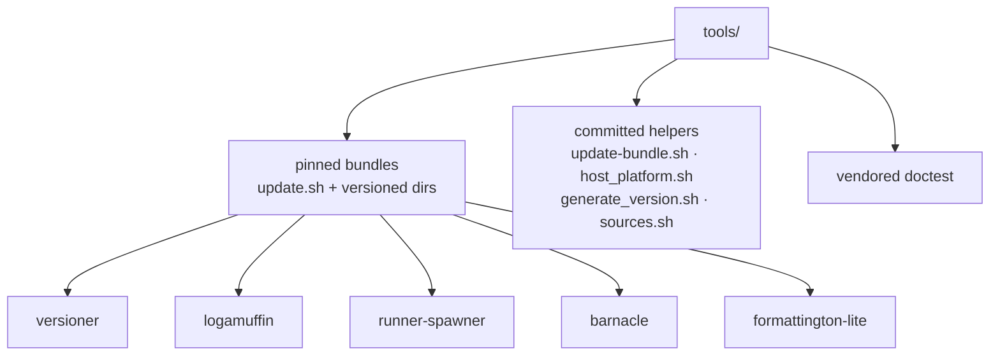

# Pinned helper tools (`tools/`)



`tools/` carries the repository's pinned helper binaries — build, release, logging, versioning, and docs tooling — plus one `update.sh` per bundle that refreshes it. These are **not** the tools this repository builds (that's `logamuffin` itself, at the repo root); they are the tools used to build, test, log, and document this repository.

## Bundling convention

Every bundle follows the same layout:

```text
tools/<name>/
  update.sh           # refresh from the upstream GitHub release
  v<version>/<platform>/<binary>[.exe]
```

- Binaries are pinned by version directory; the pinned version is named by `*_VERSION_DIR` in [`scripts/.common.env`](../scripts/env.sh.md).
- `<platform>` is the hyphenated `<os>-<arch>` name (`linux-x86_64`, `macos-arm64`, `windows-x86_64`, …).
- Each `update.sh` is a thin wrapper around [update-bundle.sh](update-bundle.sh.md), the shared implementation: resolves the tag (latest release, or `--tag`), downloads via `gh`, verifies checksums when the release ships them, stages into a temporary directory, and swaps in atomically — a failed refresh leaves the previous bundle intact. Each has `--dry-run`, `--help`, and resolves its own directory.

## The bundles

| Tool | Used for | Docs |
| --- | --- | --- |
| [versioner](versioner/update.sh.md) | Computes the repository version (tag) for builds and releases | [update.sh](versioner/update.sh.md) |
| [logamuffin](logamuffin/update.sh.md) | Structured logging backend for `log()` in the tooling/scripts | [update.sh](logamuffin/update.sh.md) |
| [runner-spawner](runner-spawner/update.sh.md) | Manages self-hosted CI runners (driven by `.runner-spawner.json`) | [update.sh](runner-spawner/update.sh.md) |
| [barnacle](barnacle/update.sh.md) | Renders this documentation site | [update.sh](barnacle/update.sh.md) |
| [formattington-lite](formattington-lite/update.sh.md) | Slim formattington bundle (all platforms committed) | [update.sh](formattington-lite/update.sh.md) |

Pins currently named by `scripts/.common.env`: `VERSIONER v0.0.3.0.5`, `LOGAMUFFIN v254.1.3.0.47`, `RUNNER_SPAWNER v0.0.1.2.6`, `BARNACLE v254.0.1.1.22` (formattington-lite is pinned by its own version directory, `tools/formattington-lite/v0.0.2.0.53/`, and is not wired into the environment cascade). All four cascaded bundles are committed to git, including the logamuffin binaries.

`<platform>` archives are native (`.tar.gz` on macOS/Linux, `.zip` on Windows); there is no 7zip dependency unless a legacy release ships `.7z` assets (still accepted as a fallback).

## Other entries in `tools/`

- [update-bundle.sh.md](update-bundle.sh.md) — the shared implementation behind every `update.sh` above (tag resolution, download, checksum verification, staging, atomic swap); each bundle's wrapper only exports `TOOL_*` configuration.
- [host_platform.sh.md](host_platform.sh.md) — sourced helpers for host platform detection and bundled-Versioner resolution (`host_platform`, `locate_versioner`, `parse_shell_export`); used by `generate_version.sh`, `scripts/release.sh`, and `scripts/demo.sh`.
- [generate_version.sh.md](generate_version.sh.md) — `generate_version.sh` regenerates `.version/version.hpp` from git history via the bundled Versioner binary.
- [sources.sh.md](sources.sh.md) — `sources.sh` is the single source list for build translation units (`SOURCES`/`UNIT_SOURCES`), sourced by `build.sh` and `run_tests.sh`.
- [doctest/](doctest/README.md) — vendored doctest 2.5.3 single header for the unit tests (no `update.sh`; see its page).

`scripts/.common.env` and `scripts/.<platform>.env` select the cascaded bundles via `*_VERSION_DIR`/`*_BIN`; see [../scripts/env.sh.md](../scripts/env.sh.md).

## Refreshing a pinned tool

```bash
tools/barnacle/update.sh            # download the latest release, verify, swap
tools/barnacle/update.sh --dry-run  # show what would change
```

(Same flags for every bundle.) All five verifiers accept `checksums.txt` or `SHA256SUMS.txt`; missing checksums are a warning, **except** runner-spawner, which refuses to install unverified binaries. Legacy `.7z` assets are still readable (a p7zip install is only needed until new releases ship platform-native archives). After refreshing, update the `*_VERSION_DIR` in `scripts/.common.env` to the new tag.

## Related pages

- [../scripts/env.sh.md](../scripts/env.sh.md) — how the cascade selects these binaries
- [../scripts/docs.sh.md](../scripts/docs.sh.md) — barnacle in action
- [../scripts/release.sh.md](../scripts/release.sh.md) — the release pipeline
- [../README.md](../README.md)
