# The barnacle bundle (`tools/barnacle/`)

```mermaid
flowchart LR
    Up("<img src='barnacle:terminal.svg' width='20' alt=''/><br/>update.sh<br/>thin wrapper") --> Core("<img src='barnacle:terminal.svg' width='20' alt=''/><br/><u>../update-bundle.sh<br/>shared implementation</u>")
    Core --> Tag{{"<img src='barnacle:hexagon.svg' width='20' alt=''/><br/>resolve tag<br/>latest release or --tag"}}
    Tag --> DL("<img src='barnacle:download.svg' width='20' alt=''/><br/>gh release download")
    DL --> Sum{{"<img src='barnacle:hexagon.svg' width='20' alt=''/><br/>checksums.txt<br/>shipped?"}}
    Sum -->|yes| Verify("<img src='barnacle:check.svg' width='20' alt=''/><br/>verify SHA256")
    Sum -->|no| Warn("<img src='barnacle:triangle-exclamation-point.svg' width='20' alt=''/><br/>warn, keep going")
    Verify --> Stage("<img src='barnacle:folder.svg' width='20' alt=''/><br/>stage into v…/platform/<br/>binary + LICENSE")
    Warn --> Stage
    Stage --> Swap("<img src='barnacle:refresh-cw.svg' width='20' alt=''/><br/>swap in,<br/>remove superseded")
    Swap --> Smoke("<img src='barnacle:check.svg' width='20' alt=''/><br/>host binary reports<br/>its version")
    click Core href "../update-bundle.sh.md"
    class Up,Core shFile
    class Tag,Sum hexNode
    class DL dlNode
    class Verify,Smoke checkNode
    class Stage folder
    classDef shFile fill:#abe07a,stroke:#3f6212,color:#16280a
    classDef hexNode fill:#ffe08a,stroke:#a16207,color:#422006
    classDef dlNode fill:#93e2e2,stroke:#0f766e,color:#042f2e
    classDef checkNode fill:#9fe8c9,stroke:#0f766e,color:#052e22
    classDef folder fill:#f0c558,stroke:#8a6d1c,color:#332a05
```



[Barnacle](https://github.com/fordaj/barnacle) is a documentation-site generator: it renders the `.md` and `.mmd` files scattered through a repository into a static, navigable HTML site. This repository uses it to render *this* documentation; the site you may be reading was built by it.

## Layout

```text
tools/barnacle/
  update.sh                     # refresh from fordaj/barnacle releases (wrapper)
  v0.0.2.1.25/
    macos-arm64/barnacle
    macos-x86_64/barnacle
    linux-arm64/barnacle
    linux-x86_64/barnacle
    windows-arm64/barnacle.exe
    windows-x86_64/barnacle.exe
```

Pinned as `BARNACLE_VERSION_DIR=tools/barnacle/v0.0.2.1.25` in `scripts/.common.env`; selected via `BARNACLE_BIN` in the platform env files (see [../../scripts/env.sh.md](../../scripts/env.sh.md)).

## `update.sh` in detail

`update.sh` is a thin wrapper that exports `TOOL_*` configuration and execs [../update-bundle.sh.md](../update-bundle.sh.md), the shared implementation for all bundles. Barnacle specifics: no `TOOL_ASSET_SUFFIX` (every archive is consumed), `TOOL_EXTRA_FILES=LICENSE` (copied alongside the binary when present), and a missing checksums file only warns.

Assets are `barnacle-<platform>.tar.gz` (macOS/Linux) and `barnacle-<platform>.zip` (Windows), each carrying the binary at the archive root or inside a single top-level directory. The shared script:

1. Resolves the tag (latest release, or `--tag vX.Y.Z...`), validating the tag shape.
2. Downloads via `gh`, then verifies the downloaded archives against the upstream `checksums.txt`/`SHA256SUMS.txt` (`shasum -a 256 -c` or `sha256sum -c`), looking up each downloaded asset by name. A missing checksums file only warns; a mismatch is fatal.
3. Extracts each archive (`tar` for `.tar.gz`; `unzip` for `.zip`; `7z`/`7zz` as a fallback for legacy `.7z` assets), copies the binary into `v<tag>/<platform>/`, and makes it executable. LICENSE, if present in an archive, is copied alongside the binary into the per-platform directory.
4. Swaps in the new version directory and deletes superseded ones, then smoke-tests the host binary (`barnacle --version`).

Flags: `--dry-run` lists the assets without touching anything; `--tag TAG` pins a release; `--repo REPO` overrides the slug. Environment overrides: `BARNACLE_REPO`, `BARNACLE_TAG`. Only the binary is kept per platform (plus the upstream MIT LICENSE).

## How the repository uses it

[scripts/docs.sh.md](../../scripts/docs.sh.md) resolves `BARNACLE_BIN` through the [env cascade](../../scripts/env.sh.md) and generates `./site/` from the repo root; the output is git-ignored.

## Related pages

- [../README.md](../README.md) — the bundle index
- [../update-bundle.sh.md](../update-bundle.sh.md) — the shared implementation
- [../../scripts/docs.sh.md](../../scripts/docs.sh.md) — the docs generator that runs this binary
- [../../scripts/README.md](../../scripts/README.md) — the scripts that consume the bundle
