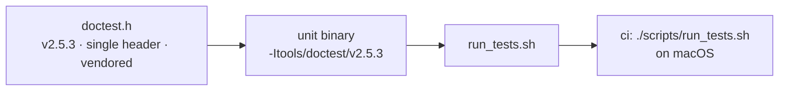

# Vendored doctest (`tools/doctest/`)



`tools/doctest/` holds the vendored third-party [doctest](https://github.com/doctest/doctest) testing framework — the C++ unit tests in `tests/unit/test_logamuffin.cpp` are built against it. It is the only third-party code vendored in this repository, and it ships as a single header, so there is no build step and no package manager involvement.

## Layout

```text
tools/doctest/
  v2.5.3/
    doctest.h
```

## Provenance (what is verifiable)

- The vendored header is doctest **v2.5.3**, committed as `tools/doctest/v2.5.3/doctest.h` in commit `7651cde` ("Add files", 2026-11-08).
- Upstream project: https://github.com/doctest/doctest.
- There is **no `update.sh`** (unlike the bundles documented in [../README.md](../README.md)); refreshing it means manually replacing the header and re-checking the include path in `run_tests.sh`.
- No license file ships in this bundle; doctest is MIT-licensed upstream (see the upstream repository). Exact provenance beyond v2.5.3 and the commit above is not recorded in-tree.

## Where it is used

`run_tests.sh` checks for `tools/doctest/v2.5.3/doctest.h` (fails fast if absent) and compiles the unit-test binary with `-Itools/doctest/v2.5.3` against `UNIT_SOURCES` (see [../sources.sh.md](../sources.sh.md)). [docs/TESTING.md](../../docs/TESTING.md) documents the unit-test architecture. `format.sh`/`ci/format_check.sh` skip `tools/doctest/` (third-party, never reformatted).

## Related pages

- [../../run_tests.sh.md](../../scripts/run_tests.sh.md) — builds and runs the unit suite
- [../sources.sh.md](../sources.sh.md) — `UNIT_SOURCES` linked into the unit binary
- [../README.md](../README.md) — the tools index
