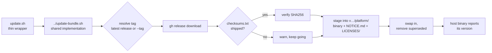

# The formattington-lite bundle (`tools/formattington-lite/`)



[Formattington](https://github.com/fordaj/formattington) is the formatter orchestrator (prettier, clang-format, shfmt and friends) used by this repository's `format.sh`/`ci/format_check.sh` — via the `pyproject.toml`/`uv.lock` Python pin, not this bundle. The `formattington-lite` bundle is a slim prebuilt binary kept in the repo for direct invocation; it is **not** wired into the environment cascade (`scripts/.common.env` pins only versioner, logamuffin, runner-spawner, and barnacle).

## Layout

```text
tools/formattington-lite/
  update.sh                     # refresh from fordaj/formattington releases (wrapper)
  v0.0.2.0.53/
    macos-arm64/formattington
    macos-x86_64/formattington
    linux-arm64/formattington
    linux-x86_64/formattington
    windows-arm64/formattington.exe
    windows-x86_64/formattington.exe
```

The bundle is pinned by its version directory (`tools/formattington-lite/v0.0.2.0.53/`); no `*_VERSION_DIR` in `scripts/.common.env` references it.

## `update.sh` in detail

`update.sh` is a thin wrapper that exports `TOOL_*` configuration and execs [../update-bundle.sh.md](../update-bundle.sh.md), the shared implementation for all bundles. Formattington-lite specifics: `TOOL_ASSET_SUFFIX=-lite` (only `-lite` archives are consumed, unlike the plain bundles), `TOOL_EXTRA_FILES=NOTICE.md`, `TOOL_EXTRA_DIRS=LICENSES`, and a missing checksums file only warns. Note the script's bundle/usage text says "formattington" for binaries while the bundle directory it manages is `tools/formattington-lite/`.

The shared script:

1. Resolves the tag (latest release, or `--tag vX.Y.Z...`), validating the tag shape.
2. Downloads only `-lite` archives via `gh` (assets without a `-lite` suffix are ignored), then verifies against upstream `checksums.txt`/`SHA256SUMS.txt` — a missing checksums file only warns; a mismatch is fatal.
3. Extracts each archive (`tar` for `.tar.gz`; `unzip` for `.zip`; `7z`/`7zz` fallback for legacy `.7z`), copies the binary into `v<tag>/<platform>/`, and makes it executable. `NOTICE.md` and `LICENSES/`, if present, are copied alongside the binary into the per-platform directory.
4. Swaps in the new version directory and deletes superseded ones, then smoke-tests the host binary (`formattington --version`).

Flags: `--dry-run`, `--tag TAG`, `--repo REPO`. Environment overrides: `FORMATTINGTON_REPO` (default `fordaj/formattington`), `FORMATTINGTON_TAG`.

## Related pages

- [../README.md](../README.md) — the bundle index
- [../update-bundle.sh.md](../update-bundle.sh.md) — the shared implementation
- [../../scripts/format.sh.md](../../scripts/format.sh.md) — the formatting workflow (pinned via uv, not this bundle)
- [../../scripts/README.md](../../scripts/README.md)
