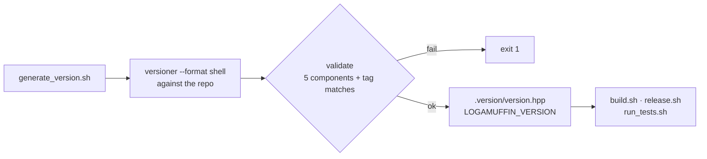

# Regenerating the version header (`tools/generate_version.sh`)



`tools/generate_version.sh` regenerates `.version/version.hpp` from git history via the bundled [Versioner](versioner/update.sh.md) binary. Build scripts call it before compiling so `logamuffin --version` always reflects the current `HEAD`. The `.version/` directory is git-ignored and must not be committed.

## Usage

```bash
tools/generate_version.sh          # regenerate .version/version.hpp
tools/generate_version.sh --help   # usage
```

Prerequisites: `git` (versioner shells out to it) and a bundled versioner binary for this host (or `VERSIONER_BIN` set to a prebuilt one). Compile with `-I.version` so `#include "version.hpp"` resolves.

## What it writes

`.version/version.hpp` defines `LOGAMUFFIN_VERSION_BRANCH`, `_MAJOR`, `_MINOR`, `_REVISION`, `_PATCH`, plus `LOGAMUFFIN_VERSION` (five-part string, e.g. `0.1.3.0.34`) and `LOGAMUFFIN_VERSION_TAG` (`v0.1.3.0.34`). The script runs `versioner --repo-dir <root> --format shell`, validates the five components and that the tag equals `v<VERSION>`, and writes the header atomically.

Environment: `VERSIONER_BIN` (prebuilt binary override), `OUTPUT_DIR` (default `<root>/.version`). Unknown arguments exit 2; validation failures exit 1.

Called by [../scripts/build.sh.md](../scripts/build.sh.md), [../scripts/release.sh.md](../scripts/release.sh.md), and [../run_tests.sh.md](../scripts/run_tests.sh.md) — all regenerate before building, so the header and binary never disagree.

## Related pages

- [versioner/update.sh.md](versioner/update.sh.md) — the bundled binary and how to refresh it
- [../scripts/build.sh.md](../scripts/build.sh.md) — caller
- [../README.md](../README.md) — "Versioning" section
