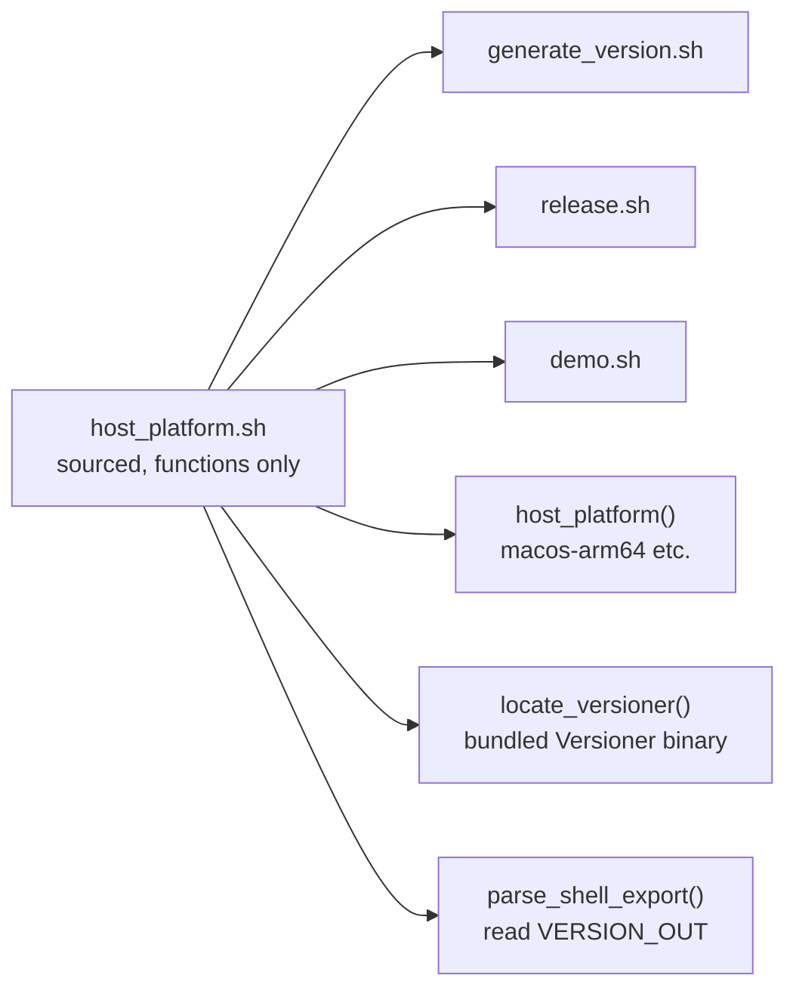

# Shared host helpers (`tools/host_platform.sh`)

`tools/host_platform.sh` is sourced — never executed — by the Bash tooling that needs to know which bundle platform the host is or where the bundled Versioner binary lives. It emits no output and sets no shell options at source time; it only defines functions. Keeping them here means one mapping to update when a platform is added.

## Functions

| Function | Sets / prints | Behavior |
| --- | --- | --- |
| `host_platform` | Prints e.g. `macos-arm64` | `Darwin→macos`, `Linux→linux`, `MINGW*`/`MSYS*`/`CYGWIN*`→`windows`; `x86_64`/`amd64→x86_64`, `arm64`/`aarch64→arm64`. Returns 1 on an unsupported host. |
| `locate_versioner <repo_root>` | Sets `VERSIONER_PATH` | Honors `VERSIONER_BIN`; otherwise picks the bundled `tools/versioner/v*/<platform>/versioner[.exe]` (newest tag directory wins). Prints a diagnostic and returns 1 when not found. |
| `parse_shell_export <name>` | Prints the value | Reads `export <name>=<value>` lines from `$VERSION_OUT`, last occurrence wins, strips one layer of surrounding single quotes (Versioner quotes only unsafe values). |

Consumers: [generate_version.sh.md](generate_version.sh.md) (version header regeneration), [../scripts/release.sh.md](../scripts/release.sh.md) (release pipeline), and [../scripts/demo.sh.md](../scripts/demo.sh.md) (platform build lookup).

## Related pages

- [README.md](README.md) — the bundle index
- [generate_version.sh.md](generate_version.sh.md) — the primary consumer
- [sources.sh.md](sources.sh.md) — the other sourced helper in `tools/`
