# The logamuffin bundle (`tools/logamuffin/`)

```mermaid
flowchart LR
    Up("<img src='barnacle:terminal.svg' width='20' alt=''/><br/>update.sh<br/>thin wrapper") --> Core("<img src='barnacle:terminal.svg' width='20' alt=''/><br/><u>../update-bundle.sh<br/>shared implementation</u>")
    Core --> Tag{{"<img src='barnacle:hexagon.svg' width='20' alt=''/><br/>resolve tag<br/>latest release or --tag"}}
    Tag --> DL("<img src='barnacle:download.svg' width='20' alt=''/><br/>gh release download")
    DL --> Sum{{"<img src='barnacle:hexagon.svg' width='20' alt=''/><br/>checksums.txt<br/>shipped?"}}
    Sum -->|yes| Verify("<img src='barnacle:check.svg' width='20' alt=''/><br/>verify SHA256")
    Sum -->|no| Warn("<img src='barnacle:triangle-exclamation-point.svg' width='20' alt=''/><br/>warn, keep going")
    Verify --> Stage("<img src='barnacle:folder.svg' width='20' alt=''/><br/>stage into v…/platform/<br/>binary only")
    Warn --> Stage
    Stage --> Swap("<img src='barnacle:refresh-cw.svg' width='20' alt=''/><br/>swap in,<br/>remove superseded")
    Swap --> Smoke("<img src='barnacle:check.svg' width='20' alt=''/><br/>host binary reports<br/>its version")
    click Core href "../update-bundle.sh.md"
    class Up,Core shFile
    class Tag,Sum hexNode
    class DL dlNode
    class Verify,Smoke checkNode
    class Stage folder
    classDef shFile fill:#abe07a,stroke:#3f6212,color:#16280a
    classDef hexNode fill:#ffe08a,stroke:#a16207,color:#422006
    classDef dlNode fill:#93e2e2,stroke:#0f766e,color:#042f2e
    classDef checkNode fill:#9fe8c9,stroke:#0f766e,color:#052e22
    classDef folder fill:#f0c558,stroke:#8a6d1c,color:#332a05
```



[Logamuffin](https://github.com/fordaj/logamuffin) is the structured logging backend: a small C++20 binary used by this repository's tooling via `scripts/entry.sh`'s `log()` (and by the fordaj ecosystem more broadly — this repository is logamuffin's source). This bundle is the prebuilt upstream binary, distinct from the `logamuffin` built from this tree.

## Layout

```text
tools/logamuffin/
  update.sh                     # refresh from fordaj/logamuffin releases (wrapper)
  v254.1.3.0.47/
    macos-arm64/logamuffin
    ...
```

`scripts/.common.env` pins `LOGAMUFFIN_VERSION_DIR=tools/logamuffin/v254.1.3.0.47` and the platform env files point `LOGAMUFFIN_BIN` at it. The binaries are committed to git (they were fetched with `update.sh`), so `scripts/entry.sh`'s `log()` forwards to the bundled binary on every platform.

Pinned as `LOGAMUFFIN v254.1.3.0.47`; see [../../scripts/env.sh.md](../../scripts/env.sh.md).

## `update.sh` in detail

`update.sh` is a thin wrapper that exports `TOOL_*` configuration and execs [../update-bundle.sh.md](../update-bundle.sh.md), the shared implementation for all bundles. Logamuffin specifics: no `TOOL_ASSET_SUFFIX`, no extra files, and a missing checksums file only warns.

Assets are `logamuffin-<platform>.tar.gz` (macOS/Linux) and `logamuffin-<platform>.zip` (Windows), carrying the binary at the archive root or inside a single top-level directory. The shared script:

1. Resolves the tag (latest release, or `--tag vX.Y.Z...`), validating the tag shape.
2. Downloads via `gh`, then verifies the downloaded archives against upstream `checksums.txt`/`SHA256SUMS.txt` (`shasum -a 256 -c` or `sha256sum -c`), looking up each asset by name. A missing checksums file only warns; a mismatch is fatal.
3. Extracts each archive (`tar` for `.tar.gz`; `unzip` for `.zip`; `7z`/`7zz` fallback for legacy `.7z`), copies the binary into `v<tag>/<platform>/`, and makes it executable. Only the binary is kept (no LICENSE copy).
4. Swaps in the new version directory and deletes superseded ones, then smoke-tests the host binary (`logamuffin --version`).

Flags: `--dry-run`, `--tag TAG`, `--repo REPO`. Environment overrides: `LOGAMUFFIN_REPO` (default `fordaj/logamuffin`), `LOGAMUFFIN_TAG`.

## How the repository uses it

`log()` in [../../scripts/entry.sh](../../scripts/entry.sh.md) forwards to `$LOGAMUFFIN_BIN` when it is executable; `log.sh` at the repo root (the user-facing Bash helper, see [../../scripts/log.sh.md](../../scripts/log.sh.md)) resolves `LOGAMUFFIN_BIN` or falls back to PATH/build outputs.

## Related pages

- [../README.md](../README.md) — the bundle index
- [../update-bundle.sh.md](../update-bundle.sh.md) — the shared implementation
- [../../scripts/entry.sh.md](../../scripts/entry.sh.md) — the `log()` that consumes this binary
- [../../scripts/env.sh.md](../../scripts/env.sh.md) — cascade and pins
