# The runner-spawner bundle (`tools/runner-spawner/`)

```mermaid
flowchart LR
    Up("<img src='barnacle:terminal.svg' width='20' alt=''/><br/>update.sh<br/>thin wrapper") --> Core("<img src='barnacle:terminal.svg' width='20' alt=''/><br/><u>../update-bundle.sh<br/>shared implementation</u>")
    Core --> Tag{{"<img src='barnacle:hexagon.svg' width='20' alt=''/><br/>resolve tag<br/>latest release or --tag"}}
    Tag --> DL("<img src='barnacle:download.svg' width='20' alt=''/><br/>gh release download")
    DL --> Sum{{"<img src='barnacle:hexagon.svg' width='20' alt=''/><br/>checksums.txt<br/>shipped?"}}
    Sum -->|yes| Verify("<img src='barnacle:check.svg' width='20' alt=''/><br/>verify SHA256")
    Sum -->|no| Die("<img src='barnacle:circle-exclamation-point.svg' width='20' alt=''/><br/>fatal —<br/>refusing unverified binaries")
    Verify --> Stage("<img src='barnacle:folder.svg' width='20' alt=''/><br/>stage into v…/platform/<br/>binary only")
    Stage --> Swap("<img src='barnacle:refresh-cw.svg' width='20' alt=''/><br/>swap in,<br/>remove superseded")
    Swap --> Smoke("<img src='barnacle:check.svg' width='20' alt=''/><br/>host binary reports<br/>its version")
    click Core href "../update-bundle.sh.md"
    class Up,Core shFile
    class Tag,Sum hexNode
    class DL dlNode
    class Verify,Smoke checkNode
    class Die errNode
    class Stage folder
    classDef shFile fill:#abe07a,stroke:#3f6212,color:#16280a
    classDef hexNode fill:#ffe08a,stroke:#a16207,color:#422006
    classDef dlNode fill:#93e2e2,stroke:#0f766e,color:#042f2e
    classDef checkNode fill:#9fe8c9,stroke:#0f766e,color:#052e22
    classDef errNode fill:#f6b8b8,stroke:#b91c1c,color:#450a0a
    classDef folder fill:#f0c558,stroke:#8a6d1c,color:#332a05
```



[runner-spawner](https://github.com/fordaj/runner-spawner) manages self-hosted CI runners. This repository uses it to manage the runners its GitHub Actions workflow (`.github/workflows/ci.yml`) runs on; runner configuration lives in `.runner-spawner.json` (`fordaj/logamuffin`, runners `runner01`/`runner02`, group `Default`, runner version `2.338.2`, state dir `.runners/`).

## Layout

```text
tools/runner-spawner/
  update.sh                     # refresh from fordaj/runner-spawner releases (wrapper)
  v0.0.1.2.6/
    macos-arm64/runner-spawner
    macos-x86_64/runner-spawner
    linux-arm64/runner-spawner
    linux-x86_64/runner-spawner
    windows-arm64/runner-spawner.exe
    windows-x86_64/runner-spawner.exe
```

Pinned as `RUNNER_SPAWNER_VERSION_DIR=tools/runner-spawner/v0.0.1.2.6` in `scripts/.common.env`; selected via `RUNNER_SPAWNER_BIN` in the platform env files (see [../../scripts/env.sh.md](../../scripts/env.sh.md)). Note: runner-spawner reports unsupported on Linux (macOS + Windows only) — the Linux binaries ship for a uniform layout but `scripts/.linux-*.env` records that caveat.

## `update.sh` in detail

`update.sh` is a thin wrapper that exports `TOOL_*` configuration and execs [../update-bundle.sh.md](../update-bundle.sh.md), the shared implementation for all bundles. Runner-spawner specifics: no `TOOL_ASSET_SUFFIX`, no extra files, and — deliberately different from the other bundles — `TOOL_CHECKSUMS_REQUIRED=1`, so a missing checksums file is fatal (it refuses to install unverified binaries). The repo-slug env var is `RUNNER_SPAWNER_TOOL_REPO` (via `TOOL_REPO_ENV`); the tag env var is `RUNNER_SPAWNER_TAG`.

The shared script:

1. Resolves the tag (latest release, or `--tag vX.Y.Z...`), validating the tag shape.
2. Downloads via `gh`, then verifies the downloaded archives against upstream `checksums.txt`/`SHA256SUMS.txt` (`shasum -a 256 -c` or `sha256sum -c`), looking up each asset by name. A missing checksums file is fatal here; a mismatch is fatal in all cases.
3. Extracts each archive (`tar` for `.tar.gz`; `unzip` for `.zip`; `7z`/`7zz` fallback for legacy `.7z`), copies the binary into `v<tag>/<platform>/`, and makes it executable. Only the binary is kept.
4. Swaps in the new version directory and deletes superseded ones, then smoke-tests the host binary (`runner-spawner --version`).

Flags: `--dry-run`, `--tag TAG`, `--repo REPO`. Environment overrides: `RUNNER_SPAWNER_TOOL_REPO` (default `fordaj/runner-spawner`), `RUNNER_SPAWNER_TAG`.

## Related pages

- [../README.md](../README.md) — the bundle index
- [../update-bundle.sh.md](../update-bundle.sh.md) — the shared implementation
- [../../scripts/env.sh.md](../../scripts/env.sh.md) — cascade and pins
- [../../README.md](../../README.md) — "Continuous integration" section
