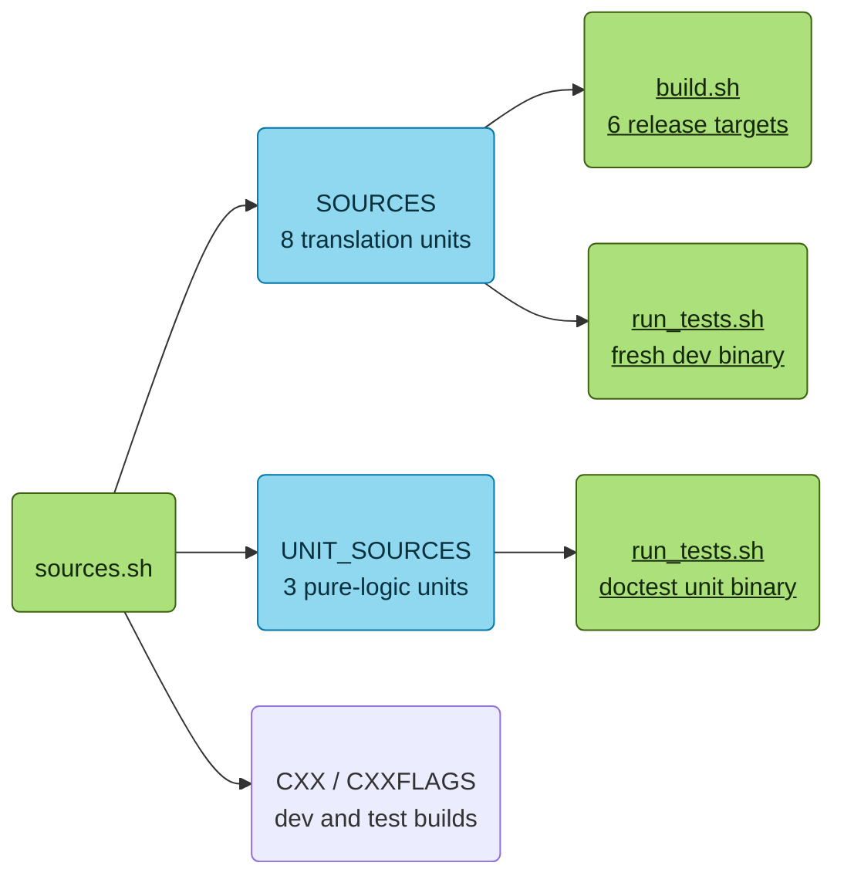

# Translation-unit list (`tools/sources.sh`)

`tools/sources.sh` is the single source of truth for which translation units make up the `logamuffin` binary and which subset the unit tests need. It is sourced — never executed — by `scripts/build.sh` and `run_tests.sh`, so adding a module means editing one list.

## What it defines

- `SOURCES` — every root-level `.cpp` compiled into the binary: `logamuffin.cpp`, `logamuffin_core.cpp`, `text_utils.cpp`, `json_parser.cpp`, `color.cpp`, `log_levels.cpp`, `config.cpp`, `platform.cpp` (8 units).
- `UNIT_SOURCES` — the subset the doctest suite links against: `logamuffin_core.cpp`, `text_utils.cpp`, `log_levels.cpp`. The unit tests exercise the pure logic only; platform I/O and CLI wiring are covered by the integration suite.
- `CXX` — native compiler for dev/test builds, defaulting to `clang++` with a fallback to `c++` (override with `CXX`).
- `CXXFLAGS` — `-std=c++20 -O0 -g3 -DDEBUG`.

Header-only `ansi_colors.hpp` needs no entry (every TU includes it directly). The vendored doctest header is not a source either; it is included via `-Itools/doctest/v2.5.3`.

## Where it is used

[../scripts/build.sh.md](../scripts/build.sh.md) (`SOURCES`), [../run_tests.sh.md](../scripts/run_tests.sh.md) (`SOURCES`, `UNIT_SOURCES`, `CXX`, `CXXFLAGS`).

## Related pages

- [../run_tests.sh.md](../scripts/run_tests.sh.md) — test builds
- [../scripts/build.sh.md](../scripts/build.sh.md) — cross-compiled release builds
- [../logamuffin.cpp.md](../logamuffin.cpp.md) — what the units implement
