# The shared bundle updater (`tools/update-bundle.sh`)

```mermaid
flowchart LR
    Wrap("<img src='barnacle:terminal.svg' width='20' alt=''/><br/>tools/&lt;name&gt;/update.sh<br/>thin wrapper") -->|"exports TOOL_* config"| Core("<img src='barnacle:terminal.svg' width='20' alt=''/><br/>update-bundle.sh")
    Core --> Tag{{"<img src='barnacle:hexagon.svg' width='20' alt=''/><br/>resolve tag<br/>latest release or --tag"}}
    Tag --> DL("<img src='barnacle:download.svg' width='20' alt=''/><br/>gh release download")
    DL --> Sum{{"<img src='barnacle:hexagon.svg' width='20' alt=''/><br/>checksums shipped?"}}
    Sum -->|yes| Verify("<img src='barnacle:check.svg' width='20' alt=''/><br/>verify SHA256")
    Sum -->|no| Policy{{"<img src='barnacle:hexagon.svg' width='20' alt=''/><br/>TOOL_CHECKSUMS_REQUIRED=1?"}}
    Policy -->|yes| Die("<img src='barnacle:circle-exclamation-point.svg' width='20' alt=''/><br/>fatal,<br/>old bundle kept")
    Policy -->|no| Warn("<img src='barnacle:triangle-exclamation-point.svg' width='20' alt=''/><br/>warn, keep going")
    Verify --> Stage("<img src='barnacle:folder.svg' width='20' alt=''/><br/>stage into v…/platform/<br/>binary + extras")
    Warn --> Stage
    Stage --> Swap("<img src='barnacle:refresh-cw.svg' width='20' alt=''/><br/>swap in,<br/>remove superseded")
    Swap --> Smoke("<img src='barnacle:check.svg' width='20' alt=''/><br/>host binary reports<br/>its version")
    class Wrap,Core shFile
    class Tag,Sum,Policy hexNode
    class DL dlNode
    class Verify,Smoke checkNode
    class Die errNode
    class Stage folder
    classDef shFile fill:#abe07a,stroke:#3f6212,color:#16280a
    classDef hexNode fill:#ffe08a,stroke:#a16207,color:#422006
    classDef dlNode fill:#93e2e2,stroke:#0f766e,color:#042f2e
    classDef checkNode fill:#9fe8c9,stroke:#0f766e,color:#052e22
    classDef errNode fill:#f6b8b8,stroke:#b91c1c,color:#450a0a
    classDef folder fill:#f0c558,stroke:#8a6d1c,color:#332a05
```

`tools/update-bundle.sh` is the single implementation behind the five bundle refresh scripts (`tools/<name>/update.sh` for barnacle, formattington-lite, versioner, runner-spawner, and logamuffin). Each wrapper exports a small `TOOL_*` configuration (name, binary, default repo, env-var prefix, asset-suffix filter, extra files/dirs, checksum policy) and execs this script, so the download/verify/stage/swap logic lives in exactly one place.

Not meant to be run directly — use the bundle's own `update.sh` (for example `tools/barnacle/update.sh`), which passes the same arguments through.

## What it does

1. Resolves the tag (latest release, or `--tag vX.Y.Z…`), validating the tag shape.
2. Downloads via `gh`, then verifies the downloaded archives against the upstream `checksums.txt`/`SHA256SUMS.txt` (`shasum -a 256 -c` or `sha256sum -c`), looking up each downloaded asset by name. A missing checksums file is fatal when the wrapper sets `TOOL_CHECKSUMS_REQUIRED=1` (runner-spawner) and only warns otherwise.
3. Filters archives by `TOOL_ASSET_SUFFIX` when set (formattington-lite consumes only `-lite` assets), extracts each (`tar` for `.tar.gz`; `unzip` for `.zip`; `7z`/`7zz` as a fallback for legacy `.7z` assets), copies the binary into `v<tag>/<platform>/`, and makes it executable. `TOOL_EXTRA_FILES` (copied with `cp -p`) and `TOOL_EXTRA_DIRS` (copied with `cp -pr`) are copied alongside when present.
4. Swaps in the new version directory and deletes superseded ones, then smoke-tests the host binary (`<binary> --version`).

## Configuration exported by the wrappers

| Variable | Meaning | Example |
| --- | --- | --- |
| `TOOL_NAME` | Bundle directory name | `barnacle` |
| `TOOL_BIN` | Binary name inside the bundle | `barnacle` |
| `TOOL_REPO_DEFAULT` | Default upstream slug | `fordaj/barnacle` |
| `TOOL_ENV_PREFIX` | Prefix for `<PREFIX>_REPO`/`<PREFIX>_TAG` | `BARNACLE` |
| `TOOL_REPO_ENV` / `TOOL_TAG_ENV` | Explicit env-var names (override the prefix) | `RUNNER_SPAWNER_TOOL_REPO` |
| `TOOL_ASSET_SUFFIX` | Only consume archives whose stem ends with this | `-lite` |
| `TOOL_EXTRA_FILES` | Extra files copied per platform if present | `NOTICE.md`, `LICENSE` |
| `TOOL_EXTRA_DIRS` | Extra directories copied per platform if present | `LICENSES` |
| `TOOL_CHECKSUMS_REQUIRED` | `1` makes missing checksums fatal | runner-spawner only |
| `TOOL_EXTRAS_NOTE` | One-line note printed in usage | `…plus NOTICE.md and LICENSES/.` |

Flags: `--dry-run` lists the assets without touching anything; `--tag TAG` pins a release; `--repo REPO` overrides the slug. Logging comes from [../scripts/entry.sh.md](../scripts/entry.sh.md); the wrapper paths keep `--dry-run` output identical to a direct run.

Checksum verification runs as `verify_downloads` (honoring `TOOL_CHECKSUMS_REQUIRED`), and the post-swap host smoke test runs as `check_host_binary` — both are functions in the shared script, not inline blocks, so the main flow stays a short sequence of download → verify → stage → swap → smoke-test.

## Related pages

- [README.md](README.md) — the bundle index and refresh instructions
- [barnacle/update.sh.md](barnacle/update.sh.md) · [formattington-lite/update.sh.md](formattington-lite/update.sh.md) · [versioner/update.sh.md](versioner/update.sh.md) · [runner-spawner/update.sh.md](runner-spawner/update.sh.md) · [logamuffin/update.sh.md](logamuffin/update.sh.md) — the wrappers
- [host_platform.sh.md](host_platform.sh.md) — shared host detection used by the build/release tooling
