# The versioner bundle (`tools/versioner/`)

```mermaid
flowchart LR
    Up("<img src='barnacle:terminal.svg' width='20' alt=''/><br/>update.sh<br/>thin wrapper") --> Core("<img src='barnacle:terminal.svg' width='20' alt=''/><br/><u>../update-bundle.sh<br/>shared implementation</u>")
    Core --> Tag{{"<img src='barnacle:hexagon.svg' width='20' alt=''/><br/>resolve tag<br/>latest release or --tag"}}
    Tag --> DL("<img src='barnacle:download.svg' width='20' alt=''/><br/>gh release download")
    DL --> Sum{{"<img src='barnacle:hexagon.svg' width='20' alt=''/><br/>checksums.txt<br/>shipped?"}}
    Sum -->|yes| Verify("<img src='barnacle:check.svg' width='20' alt=''/><br/>verify SHA256")
    Sum -->|no| Warn("<img src='barnacle:triangle-exclamation-point.svg' width='20' alt=''/><br/>warn, keep going")
    Verify --> Stage("<img src='barnacle:folder.svg' width='20' alt=''/><br/>stage into v…/platform/<br/>binary only")
    Warn --> Stage
    Stage --> Swap("<img src='barnacle:refresh-cw.svg' width='20' alt=''/><br/>swap in,<br/>remove superseded")
    Swap --> Smoke("<img src='barnacle:check.svg' width='20' alt=''/><br/>host binary reports<br/>its version")
    click Core href "../update-bundle.sh.md"
    class Up,Core shFile
    class Tag,Sum hexNode
    class DL dlNode
    class Verify,Smoke checkNode
    class Stage folder
    classDef shFile fill:#abe07a,stroke:#3f6212,color:#16280a
    classDef hexNode fill:#ffe08a,stroke:#a16207,color:#422006
    classDef dlNode fill:#93e2e2,stroke:#0f766e,color:#042f2e
    classDef checkNode fill:#9fe8c9,stroke:#0f766e,color:#052e22
    classDef folder fill:#f0c558,stroke:#8a6d1c,color:#332a05
```



[Versioner](https://github.com/fordaj/Versioner) derives a five-part version (`branch.major.minor.revision.patch`) from git history. This repository uses it to stamp every build: `scripts/build.sh`, `run_tests.sh`, `tools/generate_version.sh`, and `scripts/release.sh` all call the bundled binary so `--version` always reflects `HEAD`. `.versioner.json` configures the scheme (main exempt to branch-version `0`, other branches to `254`). See "Versioning" in [../../README.md](../../README.md) for the full story (`.version/version.hpp`, `LOGAMUFFIN_VERSION`, `LOGAMUFFIN_VERSION_TAG`).

## Layout

```text
tools/versioner/
  update.sh                     # refresh from fordaj/Versioner releases (wrapper)
  v0.0.3.0.5/
    macos-arm64/versioner
    macos-x86_64/versioner
    linux-arm64/versioner
    linux-x86_64/versioner
    windows-x86_64/versioner.exe
```

Note: no `windows-arm64` bundle exists upstream — `scripts/.windows-arm64.env` points `VERSIONER_BIN` at the `windows-x86_64` build and documents overriding it with a versioner on `PATH`.

Pinned as `VERSIONER_VERSION_DIR=tools/versioner/v0.0.3.0.5` in `scripts/.common.env`; selected via `VERSIONER_BIN` in the platform env files (see [../../scripts/env.sh.md](../../scripts/env.sh.md)).

## `update.sh` in detail

`update.sh` is a thin wrapper that exports `TOOL_*` configuration and execs [../update-bundle.sh.md](../update-bundle.sh.md), the shared implementation for all bundles. Versioner specifics: no `TOOL_ASSET_SUFFIX` (every archive is consumed), no extra files, and a missing checksums file only warns.

Assets are `Versioner-<platform>.tar.gz` (macOS/Linux) and `Versioner-<platform>.zip` (Windows). The shared script:

1. Resolves the tag (latest release, or `--tag vX.Y.Z...`), validating the tag shape.
2. Downloads via `gh`, then verifies the downloaded archives against upstream `checksums.txt`/`SHA256SUMS.txt` (`shasum -a 256 -c` or `sha256sum -c`), looking up each asset by name. A missing checksums file only warns; a mismatch is fatal.
3. Extracts each archive (`tar` for `.tar.gz`; `unzip` for `.zip`; `7z`/`7zz` fallback for legacy `.7z`), copies the binary into `v<tag>/<platform>/`, and makes it executable. Only the binary is kept.
4. Swaps in the new version directory and deletes superseded ones, then smoke-tests the host binary (`versioner --version`).

Flags: `--dry-run`, `--tag TAG`, `--repo REPO`. Environment overrides: `VERSIONER_REPO` (default `fordaj/Versioner`), `VERSIONER_TAG`.

## Related pages

- [../README.md](../README.md) — the bundle index
- [../update-bundle.sh.md](../update-bundle.sh.md) — the shared implementation
- [../generate_version.sh.md](../generate_version.sh.md) — what consumes this binary to write `.version/version.hpp`
- [../../scripts/version.sh.md](../../scripts/version.sh.md) — read-only version printing
- [../../scripts/release.sh.md](../../scripts/release.sh.md) — releases tagged with this version
